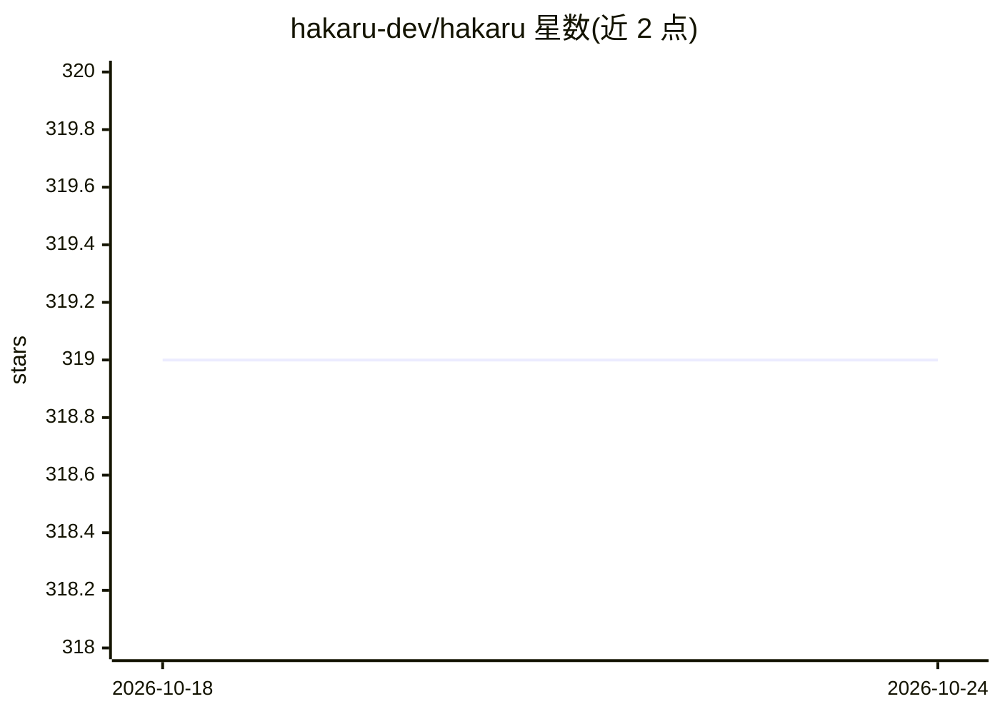

# hakaru-dev/hakaru

⭐ 319 · Haskell · BSD-3-Clause · 推送 2026-03-31 · [GitHub](https://github.com/hakaru-dev/hakaru) · 组织维护

**简单类型概率编程语言，用于指定概率模型与推断算法**

Hakaru 是一门简单类型的概率编程语言，面向概率模型与推断算法的规格化设计。它提供表示概率分布、查询与推断的语言，并基于计算机代数方法对概率信息做变换（如条件概率与概率推断），以模块化方式构造推断程序。可用于辅助机器学习应用与随机建模。README 声明代码处于 alpha 实验阶段，安装指南见其文档站点，联系邮箱为印第安纳大学 ppaml。以 Haskell 实现，托管于 Hackage。

## 筛选速览

| 维度 | 判定 | 备注 |
|---|---|---|
| AI 角色 | `ai-ecosystem` | LLM/agent 周边工具 |
| 许可风险 | `permissive` | BSD-3-Clause |
| 部署形态 | `None` |  |
| 模型依赖 | — | README 未给出锁定关系 |
| 硬件要求 | — | 无带数字的原话,不猜 |
| 安装摩擦 | `low` | 无编译、无系统依赖或容器化 |
| 成熟度 | `idea` | |

## 能力要点

- 提供表示概率分布、查询与推断的语言
- 基于计算机代数变换概率信息（条件概率、概率推断）
- 通过程序变换实现模块化概率推断

## 适用场景

- 指定概率模型并执行推断
- 随机建模与回答变量查询和分布
- 构建机器学习应用的概率推断部分

## 场景标签

 · 领域:机器学习/概率编程语言

## 证据(README 行号)

> L8: Hakaru is a simply-typed probabilistic programming language, designed for easy specification of probabilistic models
> L20: Contact us at ppaml@indiana.edu if you have any questions or concerns.

## 星数曲线

2026-10-18 319 → 2026-10-24 319（+0）

---
*卡片 v1 · prompt 1.4 · 生成 2026-10-21 · 置信度 high · 依据 README sha `45923e7bf8bd` · [字段定义](../../DATASET.md)*
