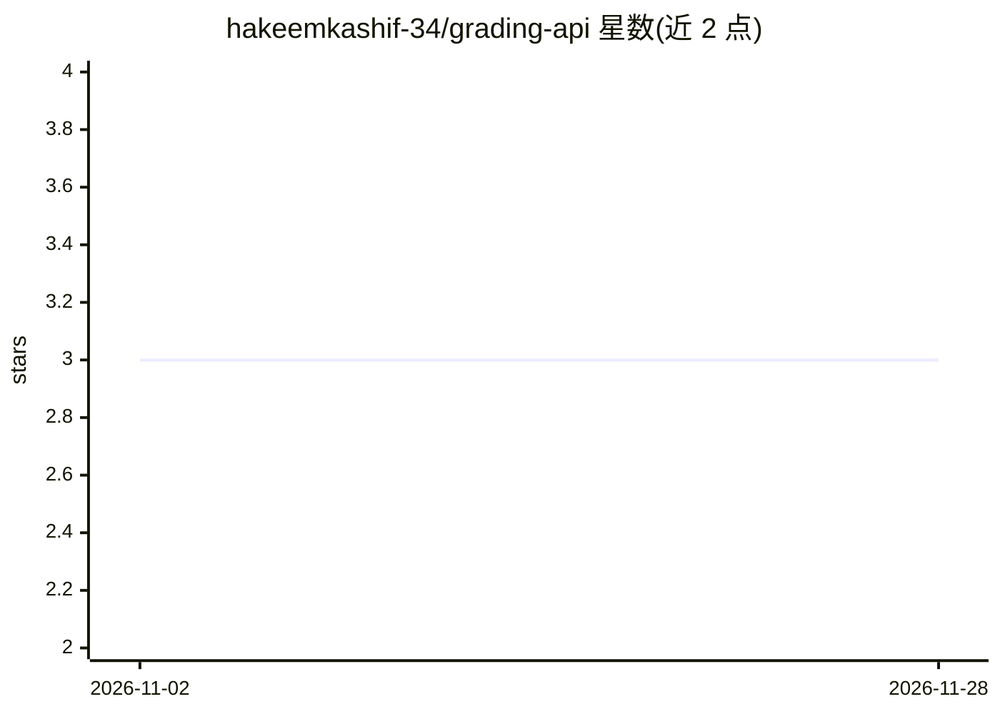

# hakeemkashif-34/grading-api

⭐ 3 · Java · 推送 2026-10-23 · [GitHub](https://github.com/hakeemkashif-34/grading-api) · [官网](https://www.youtube.com/watch?v=dd3trAH_h2Q) · 个人维护

**教师上传批改试卷照片，自动抽取学生姓名、成绩与课程信息**

基于 Java Servlet/JSP 的 Web 应用：教师在网页上传批改过的试卷照片，servlet 校验并编码图像后调用 OpenAI GPT-4o 视觉模型，按预设评分标准与回复格式解析，抽取学生姓名、成绩、课程代码与知识点，并将等级成绩换算为百分比。无成绩时返回"未找到成绩"。个人课程项目（11 年级，2024 年），需 Java 21、Maven、Tomcat 7 与 OpenAI API key，输出经 HTML 转义防 XSS。

## 筛选速览

| 维度 | 判定 | 备注 |
|---|---|---|
| AI 角色 | `ai-native` | 本体是模型或模型工具 |
| 许可风险 | `none` | — |
| 部署形态 | `None` |  |
| 模型依赖 | — | README 未给出锁定关系 |
| 硬件要求 | — | 无带数字的原话,不猜 |
| 安装摩擦 | `medium` | 含编译或系统依赖之一 |
| 成熟度 | `idea` | |

## 能力要点

- GPT-4o 视觉模型读取试卷照片并抽取结构化字段
- 等级成绩（Level 1-4+）到百分比的换算表
- API key 从环境变量读取、输出 HTML 转义等安全处理
- Maven Tomcat 插件方式本地运行

## 适用场景

- 教师批量录入纸质批改试卷的成绩信息
- 将等级制评分快速换算为百分比
- 作为调用视觉模型做信息抽取的学习参考项目

## 场景标签

`文档解析` · 领域:知识与检索

## 证据(README 行号)

> L3: A Java web app that reads a photo of a marked test and pulls out the student's name, grade, course code, and topic, 
> L12: 2. A Java servlet checks that the file is an image, encodes it, and sends it to GPT-4o with a prompt that explains 

## 星数曲线

2026-11-02 3 → 2026-11-28 3（+0）

---
*卡片 v1 · prompt 1.4 · 生成 2026-11-22 · 置信度 high · 依据 README sha `c1b59ad45df0` · [字段定义](../../DATASET.md)*
