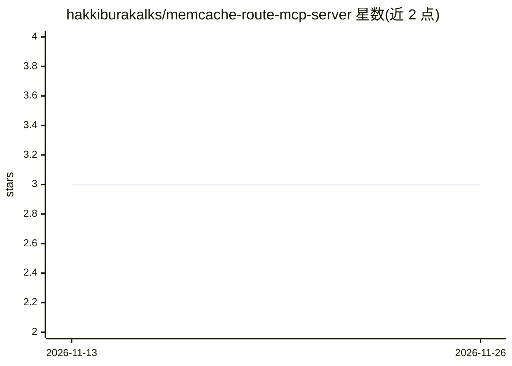

# hakkiburakalks/memcache-route-mcp-server

⭐ 3 · Rust · Apache-2.0 · 推送 2026-11-03 · [GitHub](https://github.com/hakkiburakalks/memcache-route-mcp-server) · [官网](https://github.com/hakkiburakalks/memcache-route-mcp-server/releases) · 个人维护

**为 Memcached/mcrouter 提供只读诊断分析的 MCP 服务器**

面向 Memcached 与 mcrouter 运维的 MCP 服务器，为 Claude 等 MCP 客户端提供只读访问缓存统计与诊断的能力，涵盖根因分析、容量/slab/时间线分析、集群对比、路由/TKO/迁移建议。默认只读，写入需显式开启且限定前缀并记录审计日志；支持 stdio 与 Streamable HTTP 传输、bearer token、allowlist、内存预算与审计脱敏。以 Rust 实现，提供 Linux/macOS/Windows 二进制、容器镜像与 Helm chart。状态为 early alpha（0.1.0-alpha.9）。

## 筛选速览

| 维度 | 判定 | 备注 |
|---|---|---|
| AI 角色 | `ai-ecosystem` | LLM/agent 周边工具 |
| 许可风险 | `permissive` | Apache-2.0 |
| 部署形态 | `desktop` | 安装包/桌面程序 |
| 模型依赖 | — | README 未给出锁定关系 |
| 硬件要求 | — | 无带数字的原话,不猜 |
| 安装摩擦 | `low` | 无编译、无系统依赖或容器化 |
| 成熟度 | `idea` | |

## 能力要点

- 提供 30+ 个诊断工具：节点 RCA、容量规划、slab 碎片、事故时间线、mcrouter 路由/TKO/迁移分析
- 默认只读，写入 opt-in 且前缀受限、可审计，无 flush 工具
- 支持 stdio 与 Streamable HTTP 传输，含 bearer token、每用户权限与会话/并发限额
- 提供 Linux/macOS/Windows 二进制、scratch 容器与 Helm chart

## 适用场景

- 排查 Memcached 节点的命中率下降与逐出异常
- 分析 mcrouter 的路由配置、failover 与 TKO 问题
- 对比多个缓存集群的快照找出离群节点
- 通过 Claude 对话式执行缓存容量与迁移评估

## 场景标签

 · 领域:DevOps/缓存运维诊断

## 证据(README 行号)

> L9: A community-maintained Model Context Protocol server for
> L11: Claude and other MCP clients read-only access to cache statistics, RCA, capacity/slab/timeline
> L31: - **MCP-native**: bounded resources, static investigation prompts and `server_info` structured output.

## 星数曲线

2026-11-13 3 → 2026-11-26 3（+0）

---
*卡片 v1 · prompt 1.4 · 生成 2026-11-21 · 置信度 high · 依据 README sha `5f24fa3d5855` · [字段定义](../../DATASET.md)*
