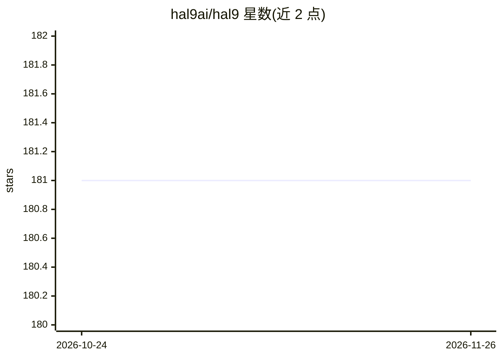

# hal9ai/hal9

⭐ 181 · Python · MIT · 推送 2026-11-21 · [GitHub](https://github.com/hal9ai/hal9) · [官网](https://hal9.com/docs/learn/code/) · 组织维护

**帮开发者用 Python 创建并部署生成式 AI 应用（聊天机器人/Agent/API）**

hal9 是一个面向生成式 AI 的 Python 包：用 input()/print()（或 h9.input/h9.complete/h9.save/h9.load 助手函数）编写聊天机器人、Agent、API 等应用，通过 hal9 create/run 本地运行，模板支持 OpenAI、Groq 等技术栈，也可配合 LangChain/DSPy。部署方面，原 Hal9 平台已转为只读并迁移到 Cloudish：应用需自带 Web 界面与 Dockerfile，由 AI 编码代理（Claude Code/Codex/Cursor）生成后部署，Cloudish 服务端构建容器并返回 HTTPS 地址。

## 筛选速览

| 维度 | 判定 | 备注 |
|---|---|---|
| AI 角色 | `ai-ecosystem` | LLM/agent 周边工具 |
| 许可风险 | `permissive` | MIT |
| 部署形态 | `self-host` | docker 或自建部署 |
| 模型依赖 | — | README 未给出锁定关系 |
| 硬件要求 | — | 无带数字的原话,不猜 |
| 安装摩擦 | `low` | 无编译、无系统依赖或容器化 |
| 成熟度 | — | 结构信号不足 |

## 能力要点

- hal9 create/run 本地创建与运行聊天机器人
- 内置 --template openai/groq 等模板生成可运行代码
- h9.save()/h9.load() 跨会话保存数据（应用进程默认无状态）
- 可打包为容器部署到 Cloudish 或其他容器平台

## 适用场景

- 快速创建并本地运行一个 LLM 聊天机器人
- 把 Python AI 应用打包成容器发布为 HTTPS 服务
- 让编码代理代为生成聊天前端、服务器和 Dockerfile

## 场景标签

`Agent 框架` `聊天机器人` · 领域:Agent 开发

## 证据(README 行号)

> L11: The `hal9` Python package is purpose-built for generative AI, enabling you to create and deploy generative (LLMs an
> L13: - **Intuitive:** No need to learn app frameworks (Flask), simply use `input()` and `print()`, or write files to dis

## 星数曲线

2026-10-24 181 → 2026-11-26 181（+0）

---
*卡片 v1 · prompt 1.4 · 生成 2026-11-26 · 置信度 mid · 依据 README sha `3018da44a6b0` · [字段定义](../../DATASET.md)*
