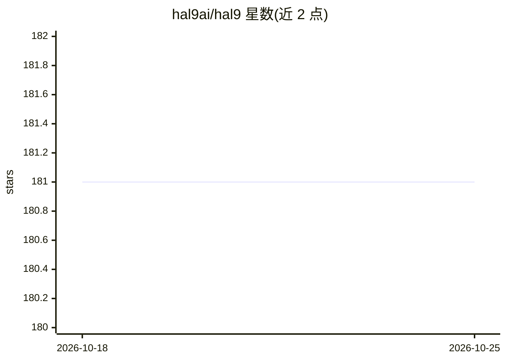

# hal9ai/hal9

⭐ 181 · Python · MIT · 推送 2026-09-11 · [GitHub](https://github.com/hal9ai/hal9) · [官网](https://hal9.com/docs/learn/code/) · 组织维护

**面向生成式 AI 应用的创建与部署平台/CLI，让开发者免写框架**

Hal9 提供以 pip 安装的 Python 包和 CLI（hal9 create/run/deploy），用于创建、本地运行和部署生成式 AI 应用（chatbot、agent、API、app）。应用代码只需用 input()/print() 读写输入输出，可配合任意库（LangChain、DSPy）与任意模型（OpenAI、Llama、Groq）。部署需 HAL9_TOKEN API token，默认部署到 hal9.com（有免费档），Docker 部署目标为计划中功能；本地运行需自行设置所选模型的 API key。由 Hal9 公司维护，另有面向创始人的付费 Startup Plan 服务。

## 筛选速览

| 维度 | 判定 | 备注 |
|---|---|---|
| AI 角色 | `ai-ecosystem` | LLM/agent 周边工具 |
| 许可风险 | `permissive` | MIT |
| 部署形态 | `self-host` | docker 或自建部署 |
| 模型依赖 | — | README 未给出锁定关系 |
| 硬件要求 | — | 无带数字的原话,不猜 |
| 安装摩擦 | `low` | 无编译、无系统依赖或容器化 |
| 成熟度 | — | 结构信号不足 |

## 能力要点

- pip 安装，hal9 create/deploy 三条命令完成聊天机器人创建与部署
- 应用代码仅需 input()/print() 读写，无需学习 Web 框架
- 可用任意库与任意模型（OpenAI、Llama、Groq、MidJourney 等）
- 提供 h9.load/save/complete 等会话状态与补全辅助函数

## 适用场景

- 快速创建并部署一个 LLM 聊天机器人
- 把生成式 AI 应用部署到 hal9.com 免费档或企业私有地址
- 用熟悉的方式（input/print 或 LangChain）编写 AI 应用，跳过前端与运维

## 场景标签

`Agent 框架` · 领域:Agent 开发

## 证据(README 行号)

> L9: Hal9 Platform is purpose-built for generative AI, enabling you to create and deploy generative (LLMs and diffusers) 
> L16: Focus on AI (RAG, fine-tuning, alignment, training) and skip engineering tasks (frontend development, backend integ

## 星数曲线

2026-10-18 181 → 2026-10-25 181（+0）

---
*卡片 v1 · prompt 1.4 · 生成 2026-10-22 · 置信度 mid · 依据 README sha `29aac6f0b00c` · [字段定义](../../DATASET.md)*
