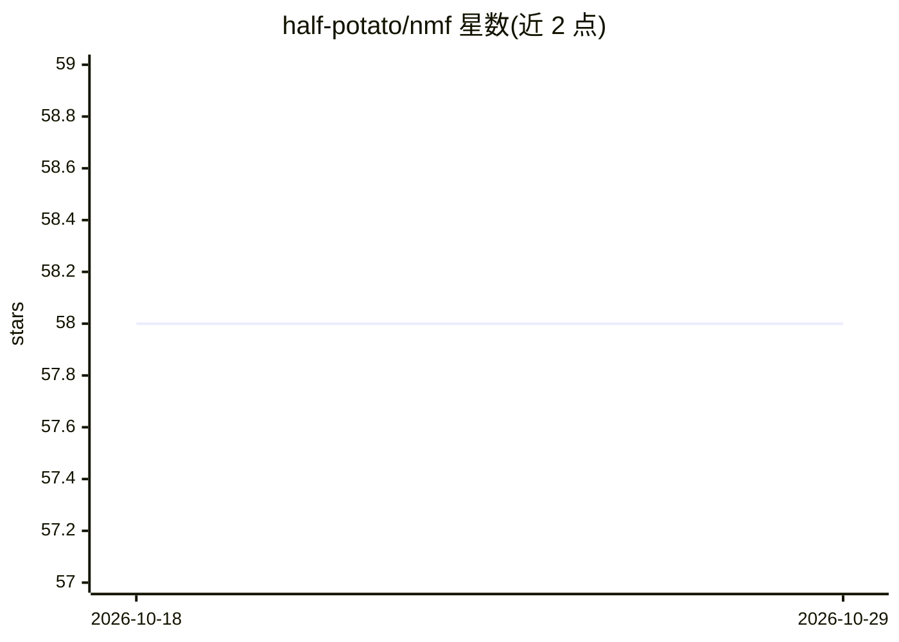

# half-potato/nmf

⭐ 58 · Jupyter Notebook · MIT · 推送 2025-12-02 · [GitHub](https://github.com/half-potato/nmf) · [官网](https://half-potato.gitlab.io/posts/nmf/) · 个人维护

**神经微面元场逆渲染方法：从多视角图像重建场景材质与光照**

论文研究代码，实现 Neural Microfacet Fields 逆渲染方法：输入一组已知相机参数的多视角图像（实验中 100 张），输出场景的体积密度、法线、材质 BRDF 与远场环境光照，并支持使用替换的环境贴图进行重光照。安装依赖 conda 虚拟环境与 requirements.txt，实验配置由 hydra 管理，训练与重光照通过 train.py 命令完成，使用 nerf_synthetic/blender 格式数据集。README 注明当前代码的指标计算存在问题，需通过附带 notebook 重新评估，重光照实验数据另行提供下载。

## 筛选速览

| 维度 | 判定 | 备注 |
|---|---|---|
| AI 角色 | `ai-native` | 本体是模型或模型工具 |
| 许可风险 | `permissive` | MIT |
| 部署形态 | `library` | 以包/库形式分发 |
| 模型依赖 | — | README 未给出锁定关系 |
| 硬件要求 | — | 无带数字的原话,不猜 |
| 安装摩擦 | `low` | 无编译、无系统依赖或容器化 |
| 成熟度 | — | 结构信号不足 |

## 能力要点

- 从多视角图像重建体积密度、法线、BRDF 材质与环境光照
- 支持训练后替换环境贴图进行重光照渲染
- 基于 hydra 的实验配置系统（configs/model、configs/dataset）
- 提供真实世界数据集配置选项

## 适用场景

- 复现论文的逆渲染与重光照实验
- 在 Blender 合成或真实世界多视角数据上重建场景材质
- 研究生成不同环境光照下的场景渲染效果

## 场景标签

`图像视频处理` · 领域:感知与多模态

## 证据(README 行号)

> L1: # Neural Microfacet Fields for Inverse Rendering
> L10: python train.py -m expname=v38_noupsample model=microfacet_tensorf2 dataset=ficus,drums,ship,teapot vis_every=5000 

## 星数曲线

2026-10-18 58 → 2026-10-29 58（+0）

---
*卡片 v1 · prompt 1.4 · 生成 2026-10-24 · 置信度 mid · 依据 README sha `f013a4e8802e` · [字段定义](../../DATASET.md)*
