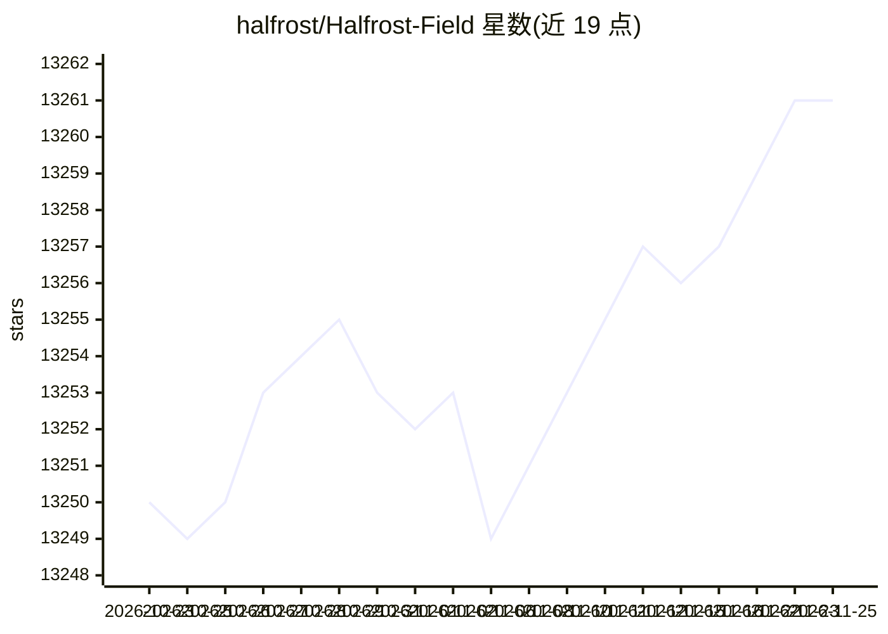

# halfrost/Halfrost-Field

⭐ 13,261 · Go · CC-BY-SA-4.0 · 推送 2026-11-10 · [GitHub](https://github.com/halfrost/Halfrost-Field) · [官网](https://halfrost.com) · 个人维护 · 中文 README

**个人工程博客：开源框架源码解析与技术笔记集合**

作者阅读开源框架源码后的心得与文章集，以目录形式组织成 LLM、Go、机器学习、JavaScript、网络协议等板块；每个条目标注对应项目与版本，文章以 Markdown 形式存于仓库并持续更新。LLM 部分为 vLLM v1 源码走读系列，覆盖请求生命周期、调度器、KV Cache 等主题；协议部分覆盖 HTTP/2、TLS 1.3、QUIC 等 RFC 解读。内容以中英双语提供，接受 PR 勘误，采用 CC BY 4.0 许可。

## 筛选速览

| 维度 | 判定 | 备注 |
|---|---|---|
| AI 角色 | `ai-knowledge` | 知识聚合/清单类 |
| 许可风险 | `viral` | CC-BY-SA-4.0 |
| 部署形态 | `None` |  |
| 模型依赖 | — | README 未给出锁定关系 |
| 硬件要求 | — | 无带数字的原话,不猜 |
| 安装摩擦 | `low` | 无编译、无系统依赖或容器化 |
| 成熟度 | — | 结构信号不足 |

## 动量与使用信号

- 维护:`active` — 距上次 push 18.2 天,年发版 0,6 位贡献者
- 涨星:近 1 天 **+1**(自 20261016 起算)
- 平台:IOS · 协议:OPENAI-API

## 能力要点

- vLLM v1 源码走读系列（调度器、Paged KV Cache、前缀缓存等）
- 覆盖 HTTP/2、TLS 1.3、QUIC、Protobuf 等协议与 RFC 解读文章
- 中英双语内容，按项目与版本组织目录
- 接受 issue/PR 形式的勘误反馈

## 适用场景

- 想深入阅读 vLLM 等框架源码时作为参考笔记
- 系统学习 HTTP/2 与 TLS 1.3 协议细节
- 按吴恩达课程大纲复习机器学习基础

## 场景标签

`教程课程` · 领域:学习与行业

## 证据(README 行号)

> L11: People often say that reading the source code of open-source frameworks can significantly improve one’s skills, so 
> L15: # 🔥 LLM

## 星数曲线

2026-10-23 13,250 → 2026-11-25 13,261（+11）

---
*卡片 v1 · prompt 1.4 · 生成 2026-11-22 · 置信度 high · 依据 README sha `8d3646c03452` · [字段定义](../../DATASET.md)*
