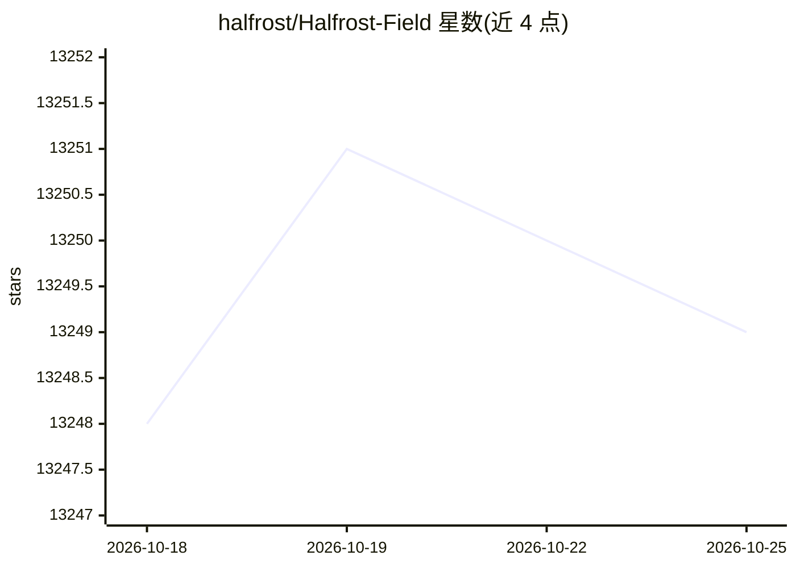

# halfrost/Halfrost-Field

⭐ 13,249 · Go · CC-BY-SA-4.0 · 推送 2026-09-30 · [GitHub](https://github.com/halfrost/Halfrost-Field) · [官网](https://halfrost.com) · 个人维护 · 中文 README

**开发者阅读开源源码与协议的技术文章集**

个人技术笔记仓库，记录作者阅读开源项目源码后的分析与心得，内容按 LLM、Go、机器学习、JavaScript、网络协议等主题以目录表形式组织，每条对应具体项目版本与系列文章。受众为希望深入理解框架源码与底层协议的开发者。仓库持续更新，支持中英双语，接受 PR/issue 勘误，文章以 Creative Commons BY 4.0 许可转载。

## 筛选速览

| 维度 | 判定 | 备注 |
|---|---|---|
| AI 角色 | `ai-knowledge` | 知识聚合/清单类 |
| 许可风险 | `viral` | CC-BY-SA-4.0 |
| 部署形态 | `None` |  |
| 模型依赖 | — | README 未给出锁定关系 |
| 硬件要求 | — | 无带数字的原话,不猜 |
| 安装摩擦 | `low` | 无编译、无系统依赖或容器化 |
| 成熟度 | — | 结构信号不足 |

## 动量与使用信号

- 维护:`active` — 距上次 push 18.2 天,年发版 0,6 位贡献者
- 涨星:近 1 天 **+1**(自 20261016 起算)
- 平台:IOS · 协议:OPENAI-API

## 能力要点

- LLM 专题收录 vLLM v1 源码系列解析（调度器、KV Cache、进程架构等）
- 覆盖 Go 内部实现、Google S2 空间索引、TLS 1.3/HTTP2/QUIC 等 RFC 级协议文章
- 中英双语内容，接受社区 PR 与 issue 勘误

## 适用场景

- 系统学习 vLLM 源码与推理引擎架构
- 查阅 HTTP/2、TLS 1.3、QUIC 等协议的中文详解
- 参考 Go 语言切片、interface、并发原语等内部实现分析

## 场景标签

`教程课程` · 领域:学习与行业

## 证据(README 行号)

> L11: People often say that reading the source code of open-source frameworks can significantly improve one’s skills, so 
> L15: # 🔥 LLM

## 星数曲线

2026-10-18 13,248 → 2026-10-25 13,249（+1）

---
*卡片 v1 · prompt 1.4 · 生成 2026-10-18 · 置信度 high · 依据 README sha `48cc8a8b92f2` · [字段定义](../../DATASET.md)*
