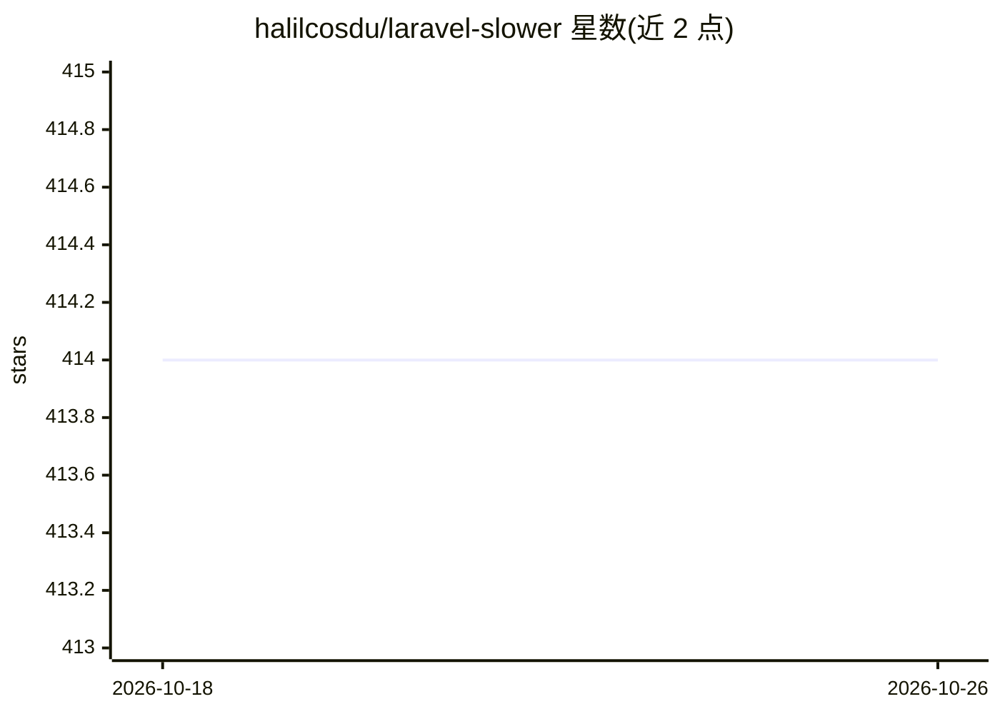

# halilcosdu/laravel-slower

⭐ 414 · PHP · MIT · 推送 2026-10-19 · [GitHub](https://github.com/halilcosdu/laravel-slower) · [官网](https://packagist.org/packages/halilcosdu/laravel-slower) · 个人维护

**Laravel 慢查询监控包：捕获慢 SQL 并由 LLM 给出优化建议**

基于 DB::listen 钩子为 Laravel 应用记录超过阈值的数据库查询，按指纹分组、记录来源（路由/队列任务/命令及 file:line），并通过 OpenAI、Anthropic、Gemini 或自定义驱动发送参数化 SQL、表结构与 EXPLAIN 计划，让 LLM 生成索引与改写建议。默认只外发参数化 SQL，不包含绑定值与字面量，可配置脱敏器。自带 /slower 仪表盘，支持采样、熔断与队列化后台分析。要求 PHP 8.3+、Laravel 11-13，经 composer 安装。

## 筛选速览

| 维度 | 判定 | 备注 |
|---|---|---|
| AI 角色 | `ai-enhanced` | 去掉 AI 部分产品仍成立 |
| 许可风险 | `permissive` | MIT |
| 部署形态 | `None` |  |
| 模型依赖 | local-ok | 支持本地模型 |
| 硬件要求 | — | 无带数字的原话,不猜 |
| 安装摩擦 | `low` | 无编译、无系统依赖或容器化 |
| 成熟度 | — | 结构信号不足 |

## 能力要点

- DB::listen 自动捕获慢查询并按指纹分组与记录来源上下文
- 将参数化 SQL、schema、EXPLAIN 计划发给 LLM 生成优化建议
- 默认隐私优先：不外发绑定值与字面量，支持 redactor 钩子
- 内置 /slower 仪表盘（搜索/过滤/分组视图/AI 分析按钮），无需前端构建

## 适用场景

- 排查 Laravel 应用中拖慢请求的数据库查询
- 让 AI 针对慢 SQL 给出加索引或改写建议
- 在生产环境留存慢查询记录并定期清理

## 场景标签

 · 领域:Web 开发/数据库可观测性

## 证据(README 行号)

> L15: Laravel Slower watches every query your application runs, captures the ones that cross your threshold, and uses AI 
> L24: - 🤖 **AI recommendations** — sends the query shape, schema, indexes, origin and a safe `EXPLAIN` plan to your LLM o
> L21: - 🚨 **Automatic capture** — a `DB::listen` hook logs every query slower than your threshold, with bindings and reso

## 星数曲线

2026-10-18 414 → 2026-10-26 414（+0）

---
*卡片 v1 · prompt 1.4 · 生成 2026-10-21 · 置信度 high · 依据 README sha `54a8b5cf39e2` · [字段定义](../../DATASET.md)*
