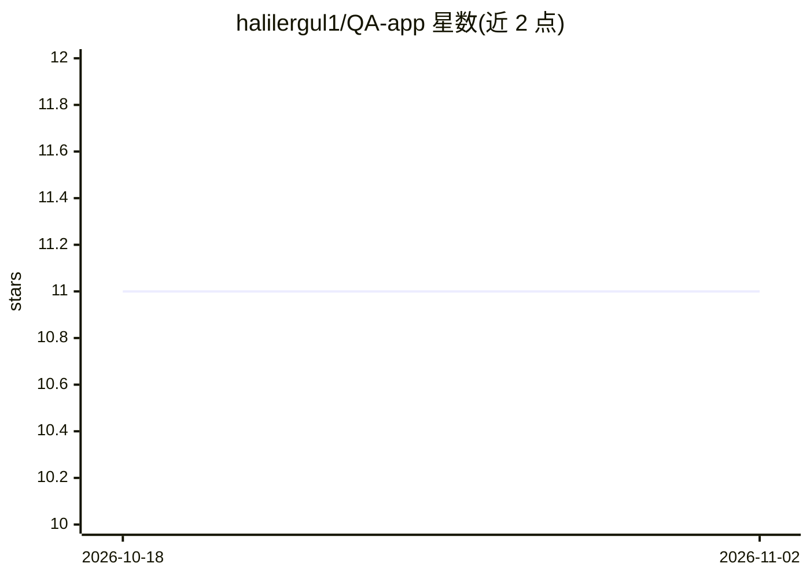

# halilergul1/QA-app

⭐ 11 · Jupyter Notebook · 推送 2026-04-10 · [GitHub](https://github.com/halilergul1/QA-app) · 个人维护

**基于 LlamaIndex 与 Elasticsearch 的自有 PDF 问答应用**

对指定文件夹内的 PDF 文档构建索引，部署 Elasticsearch 向量存储并结合 LlamaIndex 组装查询引擎，通过 FastAPI 提供 API：输入查询，返回回答及来源。数据摄取流程为 PDF→LlamaIndex 节点→Elasticsearch 向量存储，最终方案采用语义分块（semanticChunker）。附带 RelevancyEvaluator 评估脚本与 e2e 测试。需设置 OPENAI_API_KEY 环境变量，通过 Docker Compose 构建运行，本地开发可用 venv 与 pip 安装依赖。面向希望对自有文档（如公司政策文件）做问答的开发者与企业。

## 筛选速览

| 维度 | 判定 | 备注 |
|---|---|---|
| AI 角色 | `ai-native` | 本体是模型或模型工具 |
| 许可风险 | `none` | — |
| 部署形态 | `self-host` | docker 或自建部署 |
| 模型依赖 | — | README 未给出锁定关系 |
| 硬件要求 | — | 无带数字的原话,不猜 |
| 安装摩擦 | `low` | 无编译、无系统依赖或容器化 |
| 成熟度 | — | 结构信号不足 |

## 能力要点

- PDF→LlamaIndex 节点→Elasticsearch 向量存储的摄取管线
- FastAPI 接口返回回答与来源
- 语义分块（semanticChunker）为最终方案
- 附带 RelevancyEvaluator 评估与端到端测试

## 适用场景

- 对自有 PDF 文档库做问答查询
- 企业长篇政策文档的客服问答自动化
- 开发并评估基于 RAG 的问答服务

## 场景标签

`文档问答` · 领域:知识与检索

## 证据(README 行号)

> L5: Given a pdf folder consisting of various pdf files, this app deploys elastich search along with LLamaindex and can b
> L90: - **index.py**: Takes the generated nodes and setup a Elasticsearch vector store and assemble a query engine of lla

## 星数曲线

2026-10-18 11 → 2026-11-02 11（+0）

---
*卡片 v1 · prompt 1.4 · 生成 2026-11-02 · 置信度 high · 依据 README sha `a7c6a02cb5c4` · [字段定义](../../DATASET.md)*
