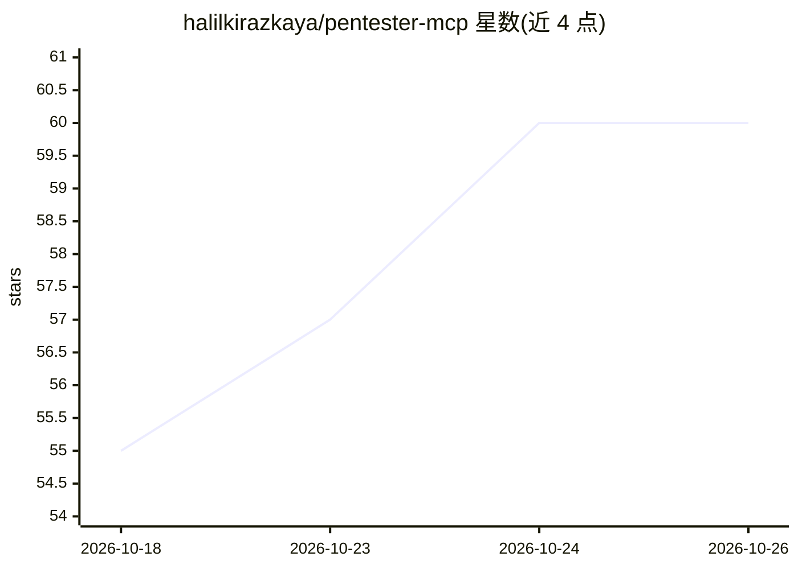

# halilkirazkaya/pentester-mcp

⭐ 60 · Python · MIT · 推送 2026-03-31 · [GitHub](https://github.com/halilkirazkaya/pentester-mcp) · 个人维护

**给开发者的 MCP 服务器：让 AI 助手调用 200+ 渗透测试工具**

基于 FastMCP 的 Model Context Protocol 服务器，将 nmap、sqlmap、ffuf、hashcat 等 200+ 个开源渗透测试工具封装为 235 个 MCP 工具，供 Claude Desktop、Cursor 等 AI 客户端调用，使 AI 能自主执行扫描与漏洞分析。采用统一服务器架构，通过 configs/*.yaml 配置启用工具。提供两种运行方式：Docker 沙箱（推荐，隔离执行环境）与本地执行（需 Kali/Parrot 等已有工具）。工具脚本由 YAML cheat sheets 自动生成，注入防 shell 注入、超时与输出截断处理。仅限授权测试用途。

## 筛选速览

| 维度 | 判定 | 备注 |
|---|---|---|
| AI 角色 | `ai-ecosystem` | LLM/agent 周边工具 |
| 许可风险 | `permissive` | MIT |
| 部署形态 | `self-host` | docker 或自建部署 |
| 模型依赖 | — | README 未给出锁定关系 |
| 硬件要求 | — | 无带数字的原话,不猜 |
| 安装摩擦 | `low` | 无编译、无系统依赖或容器化 |
| 成熟度 | — | 结构信号不足 |

## 能力要点

- 235 个 MCP 工具覆盖侦察、Web 利用、暴力破解、AD/网络等类别
- 统一服务器架构，单个配置文件选择启用工具
- Docker 沙箱隔离执行，避免主机依赖污染
- 脚本自动生成，含防 shell 注入、超时与输出截断机制

## 适用场景

- 在 Claude Desktop 或 Cursor 中自主执行 nmap/sqlmap 等渗透测试流程
- 授权安全审计中让 AI agent 调用多种测试工具
- 在隔离沙箱中为 AI 提供大规模安全工具集

## 场景标签

`网络安全` · 领域:学习与行业

## 证据(README 行号)

> L12: **Pentester-MCP** provides **Model Context Protocol (MCP)** integration for over **200+ of the most popular open-so
> L14: By adding Pentester-MCP to an AI assistant (like Claude Desktop, Cursor, or specialized agents), the AI gains the a
> L76: Unlike legacy setups requiring you to register a server per tool out of 235 options, Pentester-MCP now uses a **Uni

## 星数曲线

2026-10-18 55 → 2026-10-26 60（+5）

---
*卡片 v1 · prompt 1.4 · 生成 2026-10-24 · 置信度 mid · 依据 README sha `96385228fc83` · [字段定义](../../DATASET.md)*
