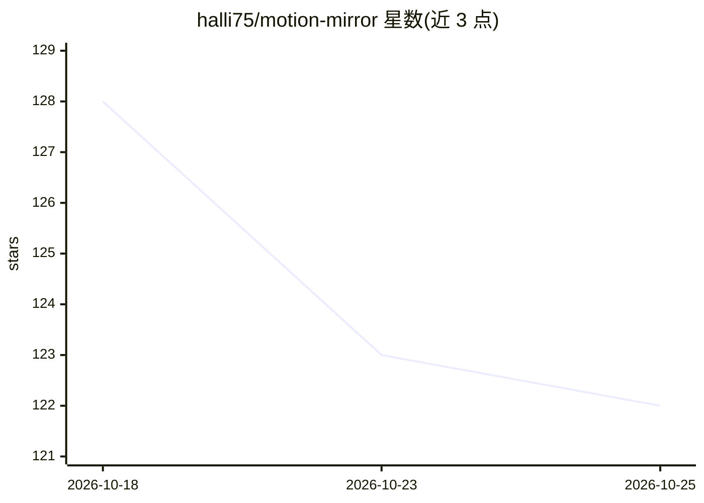

# halli75/motion-mirror

⭐ 122 · Python · MIT · 推送 2026-07-22 · [GitHub](https://github.com/halli75/motion-mirror) · 个人维护

**本地运行动作迁移工具：从参考视频驱动角色图像生成视频**

基于 Wan2.1-VACE 的本地动作迁移管线：输入一张角色图像与一段参考视频，经分割（rembg/SAM-2）、133 关键点全身骨架提取、光流估计后由 VACE 生成角色执行相同动作的视频，并透传参考视频音频。提供 CLI、Python API、Gradio Web UI 及 ComfyUI 自定义节点。后端可选 1.3B、14B GGUF 量化或全量 14B，最低约 9 GB 显存，不支持纯 CPU 生成；仅支持单人参考视频。

## 筛选速览

| 维度 | 判定 | 备注 |
|---|---|---|
| AI 角色 | `ai-native` | 本体是模型或模型工具 |
| 许可风险 | `permissive` | MIT |
| 部署形态 | `library` | 以包/库形式分发 |
| 模型依赖 | — | README 未给出锁定关系 |
| 硬件要求 | `gpu-8g` | |
| 安装摩擦 | `medium` | 含编译或系统依赖之一 |
| 成熟度 | — | 结构信号不足 |

## 能力要点

- 133 关键点全身骨架条件（身体+手+面部）
- 三种 VACE 后端（1.3B/14B GGUF/14B）与 --auto 显存自适应
- CLI、Python API、Gradio Web UI 与 ComfyUI 自定义节点
- 支持自定义 LoRA 融合与蒸馏少步快速生成

## 适用场景

- 给静态角色图套用参考视频中的人物动作
- 在消费级显卡上本地生成动作迁移视频，无需云端 API
- 在 ComfyUI 工作流中调用动作迁移节点

## 场景标签

`视频生成` · 领域:内容生成

## 证据(README 行号)

> L9: Give Motion Mirror a character image and a reference video; it produces a video of your character performing the sam
> L11: An open-source alternative to hosted motion-control tools, built on Wan2.1-VACE.
> L21: - **Multiple backends** - pick speed (1.3B), identity fidelity (14B GGUF), or full precision (14B); `--auto` select

## 星数曲线

2026-10-18 128 → 2026-10-25 122（-6）

---
*卡片 v1 · prompt 1.4 · 生成 2026-10-22 · 置信度 mid · 依据 README sha `0b5be2ca8bfd` · [字段定义](../../DATASET.md)*
