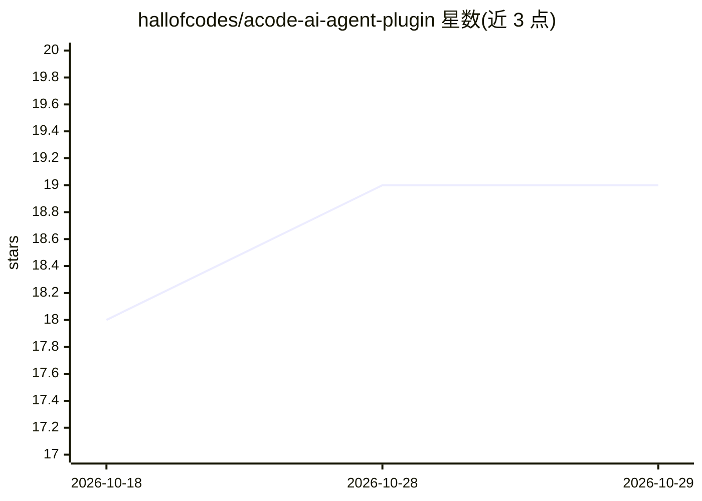

# hallofcodes/acode-ai-agent-plugin

⭐ 19 · TypeScript · MIT · 推送 2026-10-16 · [GitHub](https://github.com/hallofcodes/acode-ai-agent-plugin) · [官网](https://acode.app/plugin/hallofcodes.rutex.coding_agent) · 个人维护

**Acode 移动编辑器的自主 AI 编码代理插件**

面向 Android 端 Acode 编辑器的 AI agent 插件，使 LLM 能直接读取、创建、重命名、删除文件并执行终端命令，通过“读→析→改→验”的 agentic loop 连续执行任务。提供基于行级 diff 的精确编辑引擎（实时计算行偏移）以避免整文件覆写。支持 Gemini、OpenRouter、Ollama（需 CORS 代理）、OpenAI 四类提供商。以 TypeScript/Webpack 构建，通过工具调用协议接入 Acode API。

## 筛选速览

| 维度 | 判定 | 备注 |
|---|---|---|
| AI 角色 | `ai-ecosystem` | LLM/agent 周边工具 |
| 许可风险 | `permissive` | MIT |
| 部署形态 | `None` |  |
| 模型依赖 | local-ok | 支持本地模型 |
| 硬件要求 | — | 无带数字的原话,不猜 |
| 安装摩擦 | `low` | 无编译、无系统依赖或容器化 |
| 成熟度 | — | 结构信号不足 |

## 能力要点

- LLM 直接操作文件系统与终端命令的 agentic loop
- 行级 diff 编辑引擎，实时计算行偏移，减少 token 消耗
- 支持 Gemini / OpenRouter / Ollama / OpenAI 四类提供商
- 通过工具调用协议与 Acode API 交互

## 适用场景

- 在 Android 手机上让 AI 代为重构、编辑项目代码
- 移动端执行多文件更新与构建部署等终端任务
- 接入本地 Ollama 在移动端离线使用编码代理

## 场景标签

`编码 Agent` · 领域:编码与开发

## 证据(README 行号)

> L5: Rutex is a high-performance, autonomous AI agent plugin built specifically for the Acode mobile editor. It transform
> L21: Rutex currently supports the following AI providers, with more coming soon:

## 星数曲线

2026-10-18 18 → 2026-10-29 19（+1）

---
*卡片 v1 · prompt 1.4 · 生成 2026-10-29 · 置信度 high · 依据 README sha `c274ebeb5455` · [字段定义](../../DATASET.md)*
