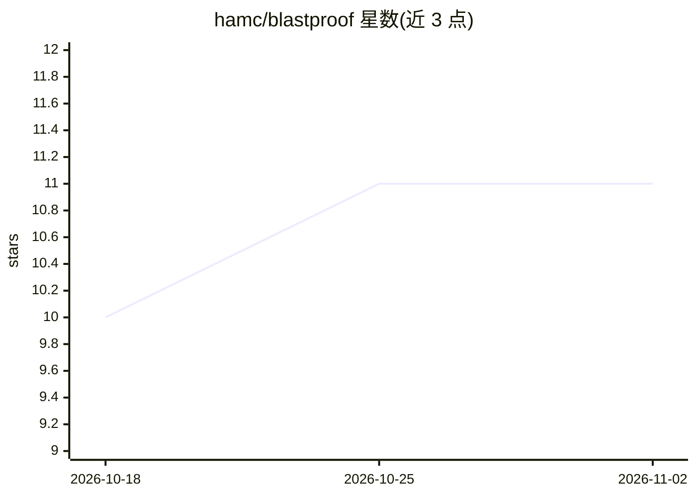

# hamc/blastproof

⭐ 11 · TypeScript · MIT · 推送 2026-10-31 · [GitHub](https://github.com/hamc/blastproof) · [官网](https://www.npmjs.com/package/blastproof) · 个人维护

**面向 PR 的 AI 端到端测试代理：按 diff 影响选跑、补草稿并打分卡合并**

Node.js CLI（Node >= 20.19）形式的 CI 端到端测试代理：以纯英文 YAML 写测试（无选择器），agent 驱动真实浏览器经无障碍树定位元素执行；将变更文件映射到路由，只跑受影响测试并产出加权分数供 --min-score 卡合并；未覆盖路由可由 blastproof plan 生成 YAML 草稿供人工审阅。BYOK（Anthropic/OpenAI key 或本地 Ollama），声明 100% 本地。硬性要求应用标记可访问（无 CSS/XPath 回退）；不支持 iframe、拖放、文件上传、多标签等；Windows 未测试。

## 筛选速览

| 维度 | 判定 | 备注 |
|---|---|---|
| AI 角色 | `ai-ecosystem` | LLM/agent 周边工具 |
| 许可风险 | `permissive` | MIT |
| 部署形态 | `library` | 以包/库形式分发 |
| 模型依赖 | local-ok | 支持本地模型 |
| 硬件要求 | — | 无带数字的原话,不猜 |
| 安装摩擦 | `low` | 无编译、无系统依赖或容器化 |
| 成熟度 | — | 结构信号不足 |

## 能力要点

- diff→影响映射→仅执行覆盖受影响路由的测试，加权分数卡合并
- 纯英文 YAML 步骤，经无障碍树按角色/标签定位元素，无选择器
- 草稿测试需人工审阅后才提交，agent 禁止编造输入值并由 runner 强制
- BYOK：Anthropic/OpenAI API key 或本地 Ollama，声明 100% 本地运行

## 适用场景

- 在 CI 中按 PR diff 只跑受影响的端到端测试并用分数卡合并
- 为缺少测试覆盖的路由生成 YAML 测试草稿
- 用自然语言编写跨桌面与移动视口（Playwright device）的 E2E 测试

## 场景标签

`浏览器自动化` · 领域:效率与自动化

## 证据(README 行号)

> L8: **Open-source AI testing agent for pull requests.** Write end-to-end tests as plain English. An agent drives a real 
> L11: git diff → impact mapping → test generation → agentic execution → report + score
> L119:  alt="How a diff becomes a merge decision. In CI, unattended: changed files are matched against the routes: and ig

## 星数曲线

2026-10-18 10 → 2026-11-02 11（+1）

---
*卡片 v1 · prompt 1.4 · 生成 2026-11-02 · 置信度 high · 依据 README sha `788a6895ddf3` · [字段定义](../../DATASET.md)*
