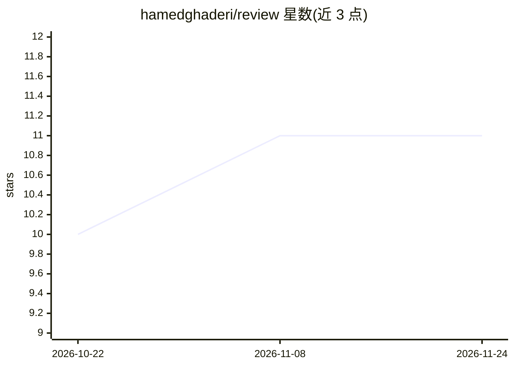

# hamedghaderi/review

⭐ 11 · TypeScript · MIT · 推送 2026-11-20 · [GitHub](https://github.com/hamedghaderi/review) · [官网](https://review-code.dev/) · 个人维护

**本地桌面代码审查工具：审 Git 分支与 GitHub PR，可选 AI 审查**

基于 Electron 的桌面应用，用于在本地审查 Git 分支与 GitHub pull request：浏览本地分支、远端与 PR，按 merge base 计算差异，评论固定在具体 commit 上，评论保存在本地 pending review，确认后才发布到 GitHub。AI 审查为可选功能，支持接入用户自己的模型或完全不使用 AI；AI 审查者可通过 MCP 工具调用外部服务器获取上下文。密钥经系统钥匙串加密。安装包尚未签名，首次打开需手动放行。

## 筛选速览

| 维度 | 判定 | 备注 |
|---|---|---|
| AI 角色 | `ai-enhanced` | 去掉 AI 部分产品仍成立 |
| 许可风险 | `permissive` | MIT |
| 部署形态 | `library` | 以包/库形式分发 |
| 模型依赖 | local-ok | 支持本地模型 |
| 硬件要求 | — | 无带数字的原话,不猜 |
| 安装摩擦 | `low` | 无编译、无系统依赖或容器化 |
| 成熟度 | — | 结构信号不足 |

## 能力要点

- 分支、远端与 GitHub PR 在同一界面浏览，⌘P 快速跳转
- 评论保存在本地 pending review，发布前不上传 GitHub
- 可选接入 OpenAI/Anthropic/Gemini/OpenRouter、OpenAI 兼容端点或 Ollama/LM Studio 本地模型
- AI 审查者可调用 MCP 服务器获取仓库外上下文

## 适用场景

- 在本地逐行评论 Git 分支改动，确认后再发布
- 审查 GitHub pull request 且评论不影响远端
- 用自选模型对代码变更做 AI 审查，或无需 AI 使用

## 场景标签

`代码审查` · 领域:编码与开发

## 证据(README 行号)

> L3:  Code review on your own machine.
> L30: - **Bring your own AI, or none.** OpenAI, Anthropic, Gemini, OpenRouter, any OpenAI-compatible endpoint, or a local

## 星数曲线

2026-10-22 10 → 2026-11-24 11（+1）

---
*卡片 v1 · prompt 1.4 · 生成 2026-11-18 · 置信度 high · 依据 README sha `48f506cbe1c1` · [字段定义](../../DATASET.md)*
