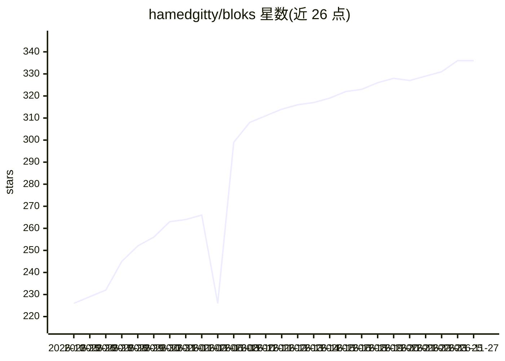

# hamedgitty/bloks

⭐ 336 · TypeScript · NOASSERTION · 推送 2026-11-26 · [GitHub](https://github.com/hamedgitty/bloks) · [官网](https://bloks.dev) · 个人维护

**本地运行的桌面端 AI agent 团队消息式客户端**

Bloks 是运行在用户自己电脑上的桌面应用，以即时消息形式组织个人 AI agent：每个 agent 是联系人，房间是群聊。底层每个 agent 对应一个真实引擎会话（Claude Code、Codex、Gemini CLI 或任意持有 key 的 API），agent 可流式回复、展示执行的命令、以可读文件保存记忆。支持多工作区隔离、邀请成员协作、用量与花费统计、月度花费上限、结构化回复（卡片/表格/图表），并提供 iPhone/Android/Watch 配套客户端作为远程窗口。需 Node 22+，FSL-1.1-MIT 许可。

## 筛选速览

| 维度 | 判定 | 备注 |
|---|---|---|
| AI 角色 | `ai-ecosystem` | LLM/agent 周边工具 |
| 许可风险 | `none` | NOASSERTION |
| 部署形态 | `desktop` | 安装包/桌面程序 |
| 模型依赖 | — | README 未给出锁定关系 |
| 硬件要求 | — | 无带数字的原话,不猜 |
| 安装摩擦 | `low` | 无编译、无系统依赖或容器化 |
| 成熟度 | — | 结构信号不足 |

## 能力要点

- 消息式界面组织多个 agent 与房间，本地运行、无账号、数据不出本机
- 每个 agent 是真实引擎会话：Claude Code、Codex、Gemini CLI 或自有 API key
- 多工作区隔离（个人/团队）、邀请码/QR 加入、角色与每人限额
- 按 agent 与引擎统计花费并设月度上限，超限可切换备用引擎

## 适用场景

- 在一台电脑上同时运行多个编程/个人 agent 并统一对话管理
- 团队邀请成员共享访问 agent 并控制各自的额度和权限
- 通过手机端远程查看与审批家中/办公室电脑上的 agent 操作

## 场景标签

`多智能体` `编码 Agent` `AI 助手` · 领域:Agent 开发

## 证据(README 行号)

> L17: Bloks is a desktop app for personal AI agents. It looks like a messaging
> L24: Underneath, every agent is a real engine session: Claude Code, Codex,
> L12:  Node 22+

## 星数曲线

2026-10-25 226 → 2026-11-27 336（+110）

---
*卡片 v1 · prompt 1.4 · 生成 2026-11-27 · 置信度 mid · 依据 README sha `896f21458e47` · [字段定义](../../DATASET.md)*
