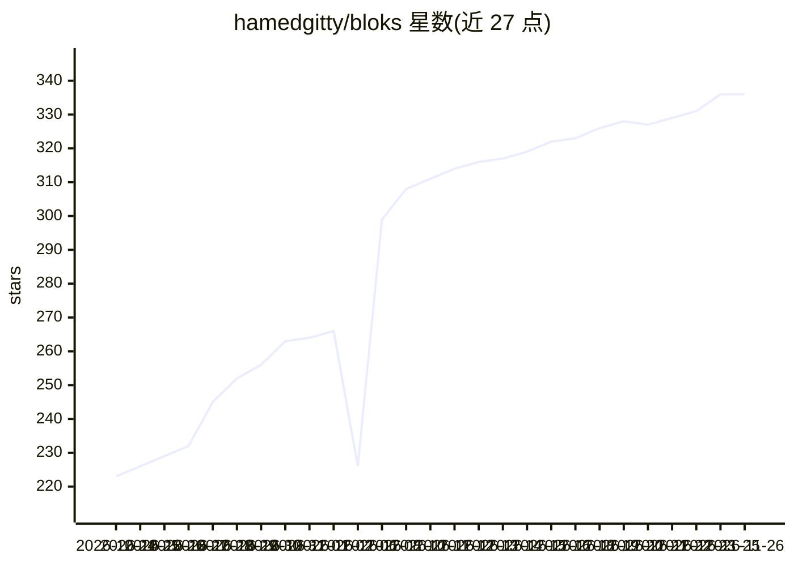

# hamedgitty/bloks

⭐ 336 · TypeScript · NOASSERTION · 推送 2026-11-24 · [GitHub](https://github.com/hamedgitty/bloks) · [官网](https://bloks.dev) · 组织维护

**本地运行的桌面应用：以聊天界面管理一组 AI agents**

Bloks 是一个运行在用户自己电脑上的桌面应用，以即时通讯形态组织 AI agents：每个 agent 是一个联系人，房间是群聊。每个 agent 底层对应一个真实引擎会话（Claude Code、Codex、Gemini CLI 等）或用户持有密钥的任意 API。支持多工作区隔离、成员邀请与权限/消费限额、按 agent 与引擎的用量统计、月度支出上限、iPhone/Apple Watch 配对远程审批，以及卡片/表格/图表等结构化回复。许可为 FSL-1.1-MIT，支持 macOS、Windows、Linux。

## 筛选速览

| 维度 | 判定 | 备注 |
|---|---|---|
| AI 角色 | `ai-ecosystem` | LLM/agent 周边工具 |
| 许可风险 | `none` | NOASSERTION |
| 部署形态 | `desktop` | 安装包/桌面程序 |
| 模型依赖 | — | README 未给出锁定关系 |
| 硬件要求 | — | 无带数字的原话,不猜 |
| 安装摩擦 | `low` | 无编译、无系统依赖或容器化 |
| 成熟度 | — | 结构信号不足 |

## 能力要点

- 以聊天界面管理多个 agent，底层为 Claude Code/Codex/Gemini CLI 等引擎会话
- 多工作区隔离：各自的 agents、记忆、密钥与房间
- 成员邀请（QR/口令/链接）与角色、私人会话、消费限额控制
- 按 agent 与引擎的用量统计及月度支出上限

## 适用场景

- 在一台电脑上集中管理多个编码/日常 agent
- 团队成员共用同一组 agents 并按人控制额度和权限
- 通过手机远程查看 agent 进度并批准其操作

## 场景标签

`多智能体` `编码 Agent` · 领域:Agent 开发

## 证据(README 行号)

> L16: Bloks is a desktop app for personal AI agents. It looks like a messaging
> L23: Underneath, every agent is a real engine session: Claude Code, Codex,
> L24: Gemini CLI and the others that run tools, or any API you hold a key for.

## 星数曲线

2026-10-24 223 → 2026-11-26 336（+113）

---
*卡片 v1 · prompt 1.4 · 生成 2026-11-25 · 置信度 mid · 依据 README sha `247f1352b58c` · [字段定义](../../DATASET.md)*
