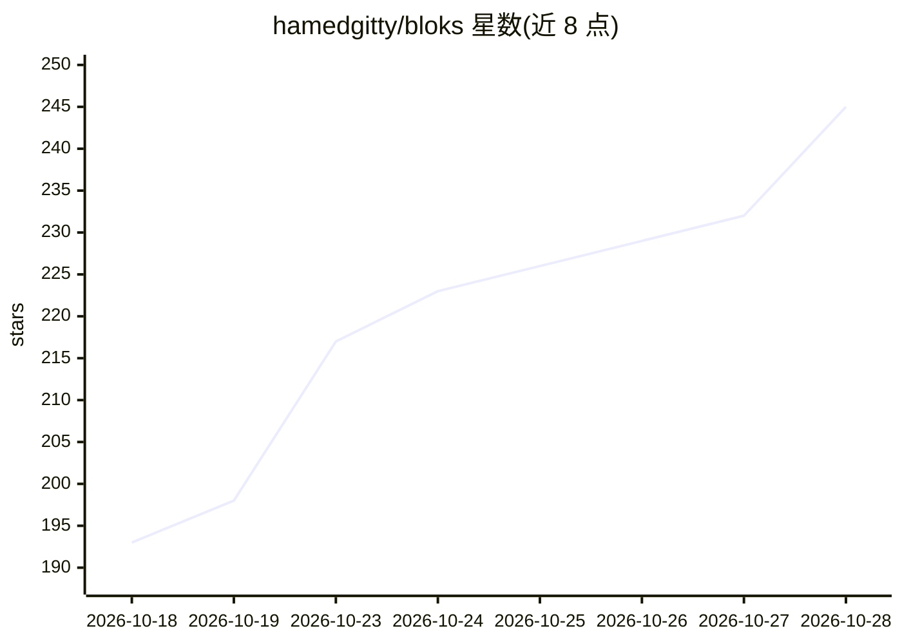

# hamedgitty/bloks

⭐ 245 · TypeScript · NOASSERTION · 推送 2026-10-27 · [GitHub](https://github.com/hamedgitty/bloks) · [官网](https://bloks.dev) · 组织维护

**本地优先的个人 AI agent 桌面工作区（Mac/Win/Linux+iPhone）**

Bloks 是一个 Electron 桌面应用，把个人 AI agent 以消息应用的形式管理：每个 agent 是一个联系人，房间即群聊，全部运行在用户自己的电脑上。底层每个 agent 是真实引擎会话（Claude Code、Codex、Gemini CLI 等，或任何持有 key 的 API），回复以卡片/表格/图表流式呈现，记忆以纯 Markdown 文件存储可读写。内置审批机制、逐句规则、回合前后快照与一键 Undo、哈希链签名日志。支持多工作区、团队成员邀请与按人/按引擎的花费限额，iPhone/Apple Watch 应用作为远程窗口配对使用，本机不运行任何东西。无账户、无官方服务器持有数据。

## 筛选速览

| 维度 | 判定 | 备注 |
|---|---|---|
| AI 角色 | `ai-native` | 本体是模型或模型工具 |
| 许可风险 | `none` | NOASSERTION |
| 部署形态 | `desktop` | 安装包/桌面程序 |
| 模型依赖 | — | README 未给出锁定关系 |
| 硬件要求 | — | 无带数字的原话,不猜 |
| 安装摩擦 | `low` | 无编译、无系统依赖或容器化 |
| 成熟度 | — | 结构信号不足 |

## 能力要点

- 每个 agent 是真实引擎会话（Claude Code/Codex/Gemini CLI 或自有 API key）
- 审批卡片、句子级规则、快照 Undo 与哈希链签名操作日志
- 多 agent 房间协作：lead 审核、提案组队、incident desk 失败移交
- 记忆为可编辑的 Markdown 文件，夜间整理且整夜可撤销

## 适用场景

- 在自己电脑上运行和管理多个个人 AI agent，与文件协同工作
- 小型团队共享 workspace，按角色和花费限额协作使用 agent
- 通过 iPhone/Apple Watch 远程查看和批准 agent 的操作
- 设置例程、文件/网页监视器让 agent 无人值守地工作

## 场景标签

`AI 助手` `多智能体` · 领域:Agent 开发

## 证据(README 行号)

> L15: Bloks is a desktop app for personal AI agents. It looks like a messaging
> L22: Underneath, every agent is a real engine session: Claude Code, Codex,

## 星数曲线

2026-10-18 193 → 2026-10-28 245（+52）

---
*卡片 v1 · prompt 1.4 · 生成 2026-10-22 · 置信度 mid · 依据 README sha `e32ad5fe1068` · [字段定义](../../DATASET.md)*
