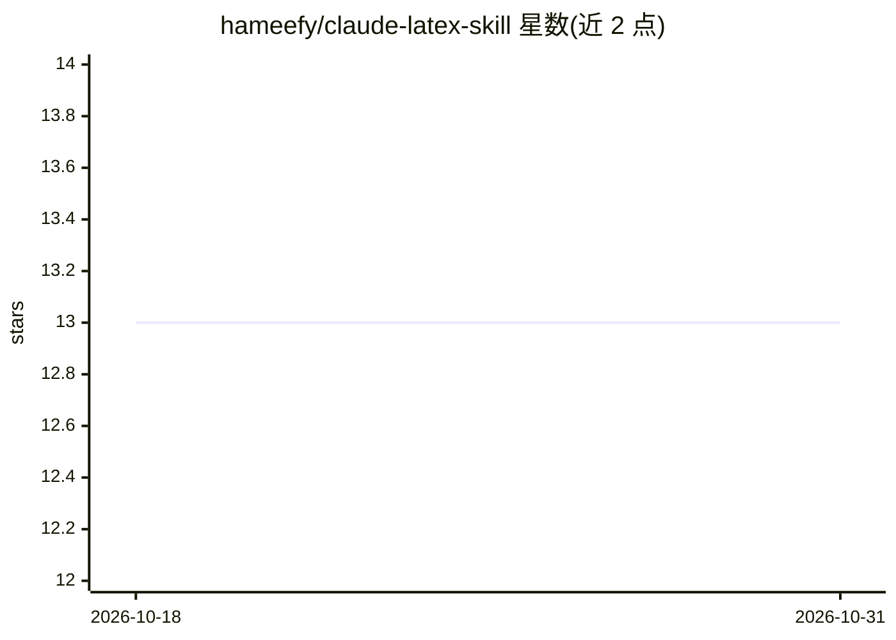

# hameefy/claude-latex-skill

⭐ 13 · MIT · 推送 2026-10-08 · [GitHub](https://github.com/hameefy/claude-latex-skill) · [官网](https://github.com/hameefy/claude-latex-skill/releases/latest) · 个人维护

**让 Claude 生成可编译数学 LaTeX 的技能文件（SKILL.md）**

面向计算与应用数学的 Claude 技能：单个 SKILL.md 文件，安装后使 Claude 按预设规则输出可直接编译的 .tex 内容，覆盖定理、证明、算法、收敛分析、数值实验与 Beamer 幻灯片，提供 Document/Snippet/Beamer 三种模式，支持从 URL 提取内容生成文档。安装途径包括 claude.ai 网页版 Skills 管理器上传、或 Claude Code 下以 curl/git clone 复制文件到 skills 目录；可选 references/ 附逆向问题材料。输出需用户自行用 pdfLaTeX 等编译。

## 筛选速览

| 维度 | 判定 | 备注 |
|---|---|---|
| AI 角色 | `ai-ecosystem` | LLM/agent 周边工具 |
| 许可风险 | `permissive` | MIT |
| 部署形态 | `desktop` | 安装包/桌面程序 |
| 模型依赖 | locked-api |  |
| 硬件要求 | — | 无带数字的原话,不猜 |
| 安装摩擦 | `low` | 无编译、无系统依赖或容器化 |
| 成熟度 | — | 结构信号不足 |

## 能力要点

- 单个 SKILL.md 文件即可安装，网页版免费 Claude 账号可用
- Document/Snippet/Beamer 三种输出模式，附预配置导言区
- 模板与示例经 pdfLaTeX 逐个编译验证并修正缺陷（v2.1）
- 支持 URL 输入生成文档、幻灯片或代码片段

## 适用场景

- 学生和研究者让 Claude 生成含定理证明的可编译 LaTeX 报告
- 教师用自然语言生成结构完整的 Beamer 讲义幻灯片
- 在 Claude Code 中按项目自动激活 LaTeX 写作规范

## 场景标签

`AI 写作` · 领域:内容生成

## 证据(README 行号)

> L11: This skill turns Claude into a **specialist LaTeX assistant** for mathematics, science, and
> L109: If you have Claude Code installed, you can install this skill permanently so it activates

## 星数曲线

2026-10-18 13 → 2026-10-31 13（+0）

---
*卡片 v1 · prompt 1.4 · 生成 2026-10-31 · 置信度 mid · 依据 README sha `c42cc23dcb9e` · [字段定义](../../DATASET.md)*
