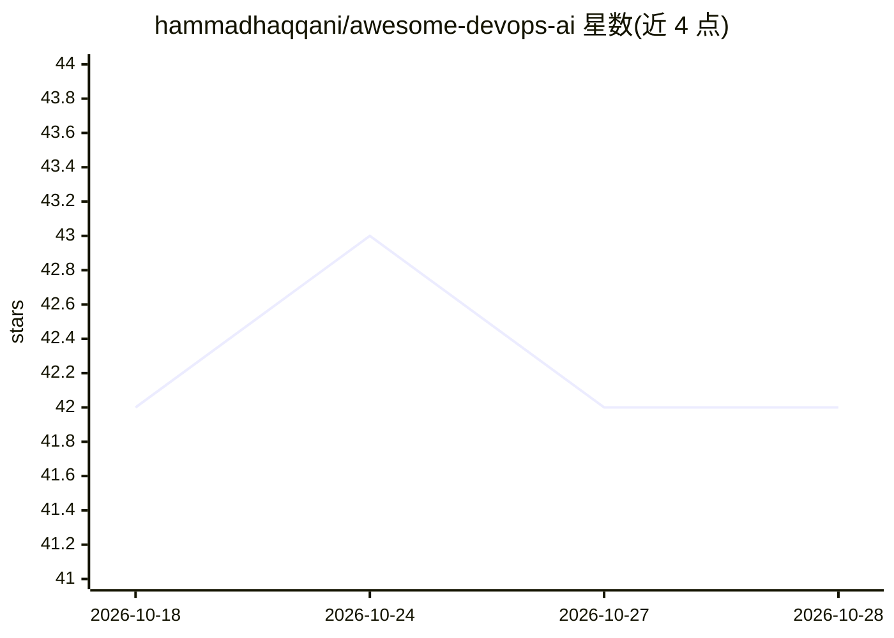

# hammadhaqqani/awesome-devops-ai

⭐ 42 · CC0-1.0 · 推送 2026-10-18 · [GitHub](https://github.com/hammadhaqqani/awesome-devops-ai) · [官网](https://hammadhaqqani.com) · 个人维护

**DevOps/SRE/平台工程领域 AI 工具策展清单（479 个工具，20 类）**

收录 DevOps、SRE 与平台工程交叉领域 AI 工具的 awesome 清单：共 479 个工具，按 20 个类别组织，覆盖基础设施编码代理、AI 驱动的 Kubernetes 管理、AI 监控、日志分析、安全、CI/CD 等方向。每个条目给出名称与一句话功能说明，并提供按角色推荐、每周工具、最热项目（按 GitHub 星标）等栏目。条目内容为外部开源仓库与产品的索引，README 未提供本清单自身的安装方式。

## 筛选速览

| 维度 | 判定 | 备注 |
|---|---|---|
| AI 角色 | `ai-knowledge` | 知识聚合/清单类 |
| 许可风险 | `viral` | CC0-1.0 |
| 部署形态 | `self-host` | docker 或自建部署 |
| 模型依赖 | — | README 未给出锁定关系 |
| 硬件要求 | — | 无带数字的原话,不猜 |
| 安装摩擦 | `low` | 无编译、无系统依赖或容器化 |
| 成熟度 | — | 结构信号不足 |

## 能力要点

- 479 个工具按 20 个类别组织，标注更新时间
- 覆盖基础设施编码代理、AI Kubernetes、监控、安全等方向
- 附每周工具推荐与按 GitHub 星标排序的最热项目表

## 适用场景

- 为 DevOps/SRE 团队选型时查找 AI 工具
- 了解 AI 在基础设施运维领域的工具分布
- 按角色获取工具推荐入口

## 场景标签

`精选清单` · 领域:学习与行业

## 证据(README 行号)

> L3: > AI tools, agents, and MCP servers for DevOps, SRE, and Platform Engineering.
> L9: **479 tools** across **20 categories** — updated September 2026. See the Quick Start Guide for role-based recommenda

## 星数曲线

2026-10-18 42 → 2026-10-28 42（+0）

---
*卡片 v1 · prompt 1.4 · 生成 2026-10-25 · 置信度 mid · 依据 README sha `10b34cfd8d80` · [字段定义](../../DATASET.md)*
