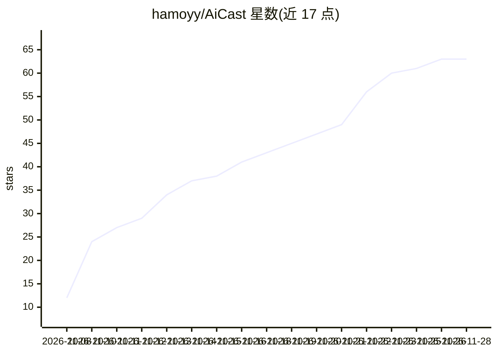

# hamoyy/AiCast

⭐ 63 · Kotlin · Apache-2.0 · 推送 2026-11-20 · [GitHub](https://github.com/hamoyy/AiCast) · [官网](https://aicast.lvchen.fun) · 个人维护 · 中文 README

**把闲置安卓设备变成 AI agent 的局域网投送屏**

由安卓 app 与 agent 技能两部分组成：设备端 app 常驻接收内容，agent 端通过 skill 目录（SKILL.md 说明书 + 零依赖 Node CLI）发现局域网设备、读取设备画像（屏幕/触摸/遥控器），生成适配的 HTML 页面投送到设备显示，支持手机点按勾选、电视遥控翻页等互动。仅限局域网，无云端、无账号，不做屏幕镜像（不支持 Miracast/AirPlay/DLNA）。兼容能读文件、执行命令的 agent（Claude Code、Codex、Cursor、DeepSeek Harness 等）。单次投送上限 4MB，历史记录保留最近 10 条，超 2MB 条目不可重播。

## 筛选速览

| 维度 | 判定 | 备注 |
|---|---|---|
| AI 角色 | `ai-ecosystem` | LLM/agent 周边工具 |
| 许可风险 | `permissive` | Apache-2.0 |
| 部署形态 | `None` |  |
| 模型依赖 | — | README 未给出锁定关系 |
| 硬件要求 | — | 无带数字的原话,不猜 |
| 安装摩擦 | `low` | 无编译、无系统依赖或容器化 |
| 成熟度 | — | 结构信号不足 |

## 能力要点

- agent 按设备画像（手机/平板/电视、触摸/遥控）自动生成适配布局
- 零依赖 CLI（Node 18+）：discover / info / render / doctor 命令
- 公开与认证两种访问模式，认证设备 30 天通行证
- 设备端 app 自检更新（sha256 + 签名校验），投送历史存本机

## 适用场景

- 把旧手机/平板/电视变成待办清单、简报轮播、数据大屏
- 用自然语言让 agent 把定制网页内容投到家里任意安卓屏
- 做互动投票、抽签、小游戏投送到电视或平板

## 场景标签

 · 领域:智能家居/数字标牌

## 证据(README 行号)

> L14: AiCast 让 agent（智能体）拥有一块屏幕：设备上装一个 app，agent 那边装好技能，你想显示什么，直接跟它说，它会把内容做成一个网页投送过去，它可以是你的待办列表、新闻简报、数据大屏、互动小游戏，也可以是 agen
> L66: 技能本体就在仓库的 `skill/` 目录里：一份 `SKILL.md`（写给 agent 看的说明书）+ 一个零依赖 CLI（`skill/bin/aicast`，只需要 Node 18+）。**所以你不用自己读文档，把网址丢给

## 星数曲线

2026-11-08 12 → 2026-11-28 63（+51）

---
*卡片 v1 · prompt 1.4 · 生成 2026-11-18 · 置信度 high · 依据 README sha `71c9bbe66f29` · [字段定义](../../DATASET.md)*
