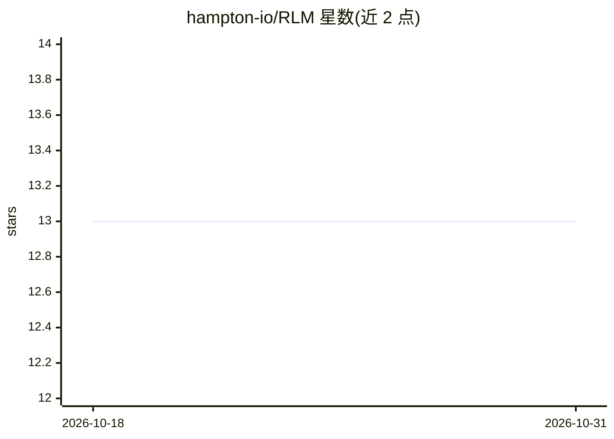

# hampton-io/RLM

⭐ 13 · TypeScript · MIT · 推送 2026-02-15 · [GitHub](https://github.com/hampton-io/RLM) · [官网](https://hampton.io) · 组织维护

**递归语言模型的 Node.js/TS 实现：让 LLM 处理任意长上下文**

基于论文 arXiv:2512.24601 的 Recursive Language Models TypeScript 实现：将长文档作为外部环境存入沙盒 JavaScript REPL，由 LLM 写代码搜索、分析和递归查询小块内容，从而处理超出上下文窗口的文档。支持 OpenAI/Anthropic/Google 多家模型、流式输出、回退链、成本追踪、会话持久化、语义分块与 Vercel 部署，另含面向 Claude Code 的 MCP 服务器提供语义代码搜索。通过 git clone 或 npm 从 GitHub 安装，需自备至少一家提供商的 API key。

## 筛选速览

| 维度 | 判定 | 备注 |
|---|---|---|
| AI 角色 | `ai-ecosystem` | LLM/agent 周边工具 |
| 许可风险 | `permissive` | MIT |
| 部署形态 | `library` | 以包/库形式分发 |
| 模型依赖 | locked-api |  |
| 硬件要求 | — | 无带数字的原话,不猜 |
| 安装摩擦 | `low` | 无编译、无系统依赖或容器化 |
| 成熟度 | — | 结构信号不足 |

## 能力要点

- REPL 式执行循环：LLM 写代码在沙盒中探索长上下文并递归派生子查询
- 多提供商支持：OpenAI、Anthropic、Google（Gemini），含推理模型自动处理
- 成本追踪、干跑估算、模型回退链与速率限制
- 附带 MCP 服务器，为 Claude Code 提供 14 种语言的语义代码搜索

## 适用场景

- 对超出模型上下文窗口的长文档做问答与摘要
- 从大文档中抽取结构化数据到 JSON/CSV
- 多文档比较与研究综述
- 在 Claude Code 中做语义代码搜索与安全扫描

## 场景标签

`RAG` `文档问答` · 领域:知识与检索

## 证据(README 行号)

> L5: RLM enables LLMs to process **arbitrarily long contexts** by treating them as an external environment that can be pr
> L83: RLM implements a REPL-style execution loop:
> L89: 5. **Recurse**: LLM can spawn sub-queries over smaller context chunks

## 星数曲线

2026-10-18 13 → 2026-10-31 13（+0）

---
*卡片 v1 · prompt 1.4 · 生成 2026-10-31 · 置信度 high · 依据 README sha `a47838276210` · [字段定义](../../DATASET.md)*
