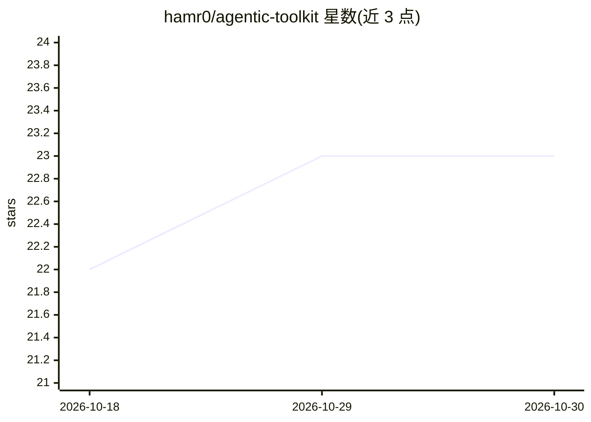

# hamr0/agentic-toolkit

⭐ 23 · JavaScript · Apache-2.0 · 推送 2026-10-21 · [GitHub](https://github.com/hamr0/agentic-toolkit) · 个人维护

**面向 AI 编程助手的 10 代理 + 12 命令工具套件，附 Linux 开发环境**

为 Claude Code、OpenCode、Amp、Droid 四种 agent CLI 提供的即用工具集：10 个可通过 @名 调用的专职代理（PRD、任务拆解、编排、编码、QA、市场研究、架构、UI 等）与 12 个命令/技能（上下文暂存 /stash→/remember、文档重组 /docs-builder、点击标注 UI 反馈 /live-canvas、自审/分支审查/发布/重构链等），部分命令可按情境自动触发。附带按发行版的 Linux 终端开发环境脚本、BYOK 与模型切换配置、策展 marketplace。工具集持续随模型演进被删改重写。

## 筛选速览

| 维度 | 判定 | 备注 |
|---|---|---|
| AI 角色 | `ai-ecosystem` | LLM/agent 周边工具 |
| 许可风险 | `permissive` | Apache-2.0 |
| 部署形态 | `library` | 以包/库形式分发 |
| 模型依赖 | local-ok | 支持本地模型 |
| 硬件要求 | — | 无带数字的原话,不猜 |
| 安装摩擦 | `low` | 无编译、无系统依赖或容器化 |
| 成熟度 | — | 结构信号不足 |

## 能力要点

- 10 个专职代理与 12 个命令/技能，覆盖 PRD→任务→实现→审查→发布流程
- /stash→/remember 用 Markdown 文件沉淀会话与跨项目摩擦点，无数据库无 RAG
- /live-canvas 在 localhost 页面上点击标注 UI 元素，批量反馈给终端 agent（JSON 模式任意工具可用，Live 模式限 Claude Code）
- AGENT_RULES.md 通用规则文档每次会话加载，更新时字节比对并备份本地修改

## 适用场景

- 在 Claude Code/OpenCode/Amp/Droid 中按名字调用专职代理执行开发流程
- 会话压缩或交接前暂存上下文并沉淀为项目规则
- 合并前做分支审查（含 OWASP 形态安全检查）与文档同步
- 一键配置 Fedora/Debian 终端开发环境（tmux、Neovim、zsh 等）

## 场景标签

`编码 Agent` `代码审查` · 领域:编码与开发

## 证据(README 行号)

> L8: **10 specialized agents · 12 commands & skills · Claude · Opencode · Ampcode · Droid**
> L34: **Agents** — invoke with `@name` (Claude / OpenCode / Amp) or `invoke droid name`.
> L66:  Claude Code and Amp ship all 12 as skills; Opencode and Droid expose all 12 as commands. All four also ship agent 

## 星数曲线

2026-10-18 22 → 2026-10-30 23（+1）

---
*卡片 v1 · prompt 1.4 · 生成 2026-10-27 · 置信度 high · 依据 README sha `9d73152e57f5` · [字段定义](../../DATASET.md)*
