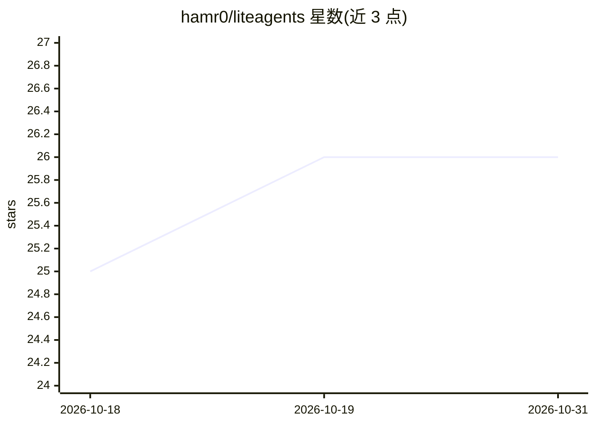

# hamr0/liteagents

⭐ 26 · JavaScript · Apache-2.0 · 推送 2026-10-30 · [GitHub](https://github.com/hamr0/liteagents) · 个人维护

**面向 Claude Code 等 CLI agent 的子代理与技能工具包**

为 Claude Code、Opencode、Ampcode、Droid 四个 agent CLI 提供的套件：10 个专门子代理（PRD 起草、任务拆解、编排、开发、QA、架构、UI 设计等）与 12 个命令/技能（上下文快照与记忆沉淀、代码自审、分支审查、发布、重构、文档整理、UI 点击批注等），通过 npx 安装复制到 ~/.claude。核心机制包括 AGENT_RULES.md 模板字节比对更新、/stash→/remember 的会话记忆管道、fix ledger 累积式重构流程；/live-canvas 的 Live 模式仅限 Claude Code。项目声明持续重写与删改。

## 筛选速览

| 维度 | 判定 | 备注 |
|---|---|---|
| AI 角色 | `ai-ecosystem` | LLM/agent 周边工具 |
| 许可风险 | `permissive` | Apache-2.0 |
| 部署形态 | `library` | 以包/库形式分发 |
| 模型依赖 | — | README 未给出锁定关系 |
| 硬件要求 | — | 无带数字的原话,不猜 |
| 安装摩擦 | `low` | 无编译、无系统依赖或容器化 |
| 成熟度 | — | 结构信号不足 |

## 能力要点

- 10 个专门子代理与 12 个命令/技能，兼容四种 agent CLI
- /stash→/remember 会话上下文快照与规则沉淀管道，纯 Markdown 无数据库
- /live-canvas 点击批注 UI 反馈（JSON 模式任意工具可用，Live 模式限 Claude Code）
- 自审/分支审查/发布/重构的 fix ledger 累积流程

## 适用场景

- 在 Claude Code 等 CLI agent 中按名调用专门子代理分工完成开发流程
- 跨会话保留项目上下文与踩坑经验
- 合并前做代码审查与安全检查，再走发布流程
- 在浏览器中点击 UI 元素向终端 agent 提交修改反馈

## 场景标签

`编码 Agent` `代码审查` · 领域:编码与开发

## 证据(README 行号)

> L10: **10 specialized agents · 12 commands & skills · Claude · Opencode · Ampcode · Droid**
> L68:  Claude Code and Amp ship all 12 as skills; Opencode and Droid expose all 12 as commands. All four also ship agent 

## 星数曲线

2026-10-18 25 → 2026-10-31 26（+1）

---
*卡片 v1 · prompt 1.4 · 生成 2026-10-26 · 置信度 high · 依据 README sha `60fdde74aac5` · [字段定义](../../DATASET.md)*
