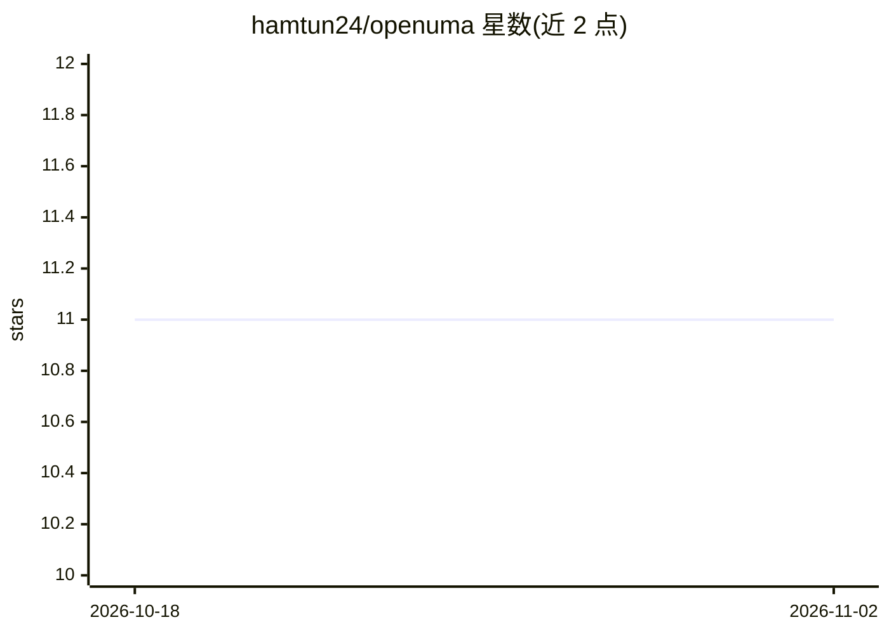

# hamtun24/openuma

⭐ 11 · Rust · MIT · 推送 2026-04-03 · [GitHub](https://github.com/hamtun24/openuma) · 个人维护

**面向 AMD APU/Intel iGPU 的统一内存抽象中间件，生成 AI 推理配置**

Rust 编写的中间件：自动检测 AMD APU 与 Intel iGPU 硬件、配置统一内存池（iGPU/CPU 内存分配、零拷贝 DMA-BUF），并为 llama.cpp、Ollama、KTransformers 等推理引擎生成配置。提供 CLI 与交互式 TUI，支持探测硬件、按模型计算内存分区、运行 llama.cpp 推理基准测试。以预编译二进制（Linux/macOS/Windows）与源码编译两种方式安装；Linux 可选安装 Vulkan 驱动；REST API serve 标注为 v0.7 计划功能。

## 筛选速览

| 维度 | 判定 | 备注 |
|---|---|---|
| AI 角色 | `ai-ecosystem` | LLM/agent 周边工具 |
| 许可风险 | `permissive` | MIT |
| 部署形态 | `desktop` | 安装包/桌面程序 |
| 模型依赖 | local-ok | 支持本地模型 |
| 硬件要求 | — | 无带数字的原话,不猜 |
| 安装摩擦 | `medium` | 含编译或系统依赖之一 |
| 成熟度 | — | 结构信号不足 |

## 能力要点

- 自动检测 AMD APU 与 Intel iGPU 硬件档案
- 零拷贝 DMA-BUF 的 CPU/iGPU 内存分区配置
- 为 llama.cpp / Ollama / KTransformers 生成引擎配置
- 集成 TUI 硬件监控与 llama.cpp 推理基准测试

## 适用场景

- 在核显轻薄本上为本地 LLM 推理生成引擎配置
- 检测 APU/iGPU 共享内存并规划模型内存分区
- 对比不同配置下的本地推理速度

## 场景标签

`推理引擎` · 领域:训练与推理

## 证据(README 行号)

> L3: **OpenUMA** (Unified Memory Abstraction) is a Rust middleware for detecting shared memory hardware (AMD APUs, Intel 
> L23: - **Multiple Engines** - Generate configs for llama.cpp, Ollama, and KTransformers

## 星数曲线

2026-10-18 11 → 2026-11-02 11（+0）

---
*卡片 v1 · prompt 1.4 · 生成 2026-11-02 · 置信度 high · 依据 README sha `eb77e4da5a0c` · [字段定义](../../DATASET.md)*
