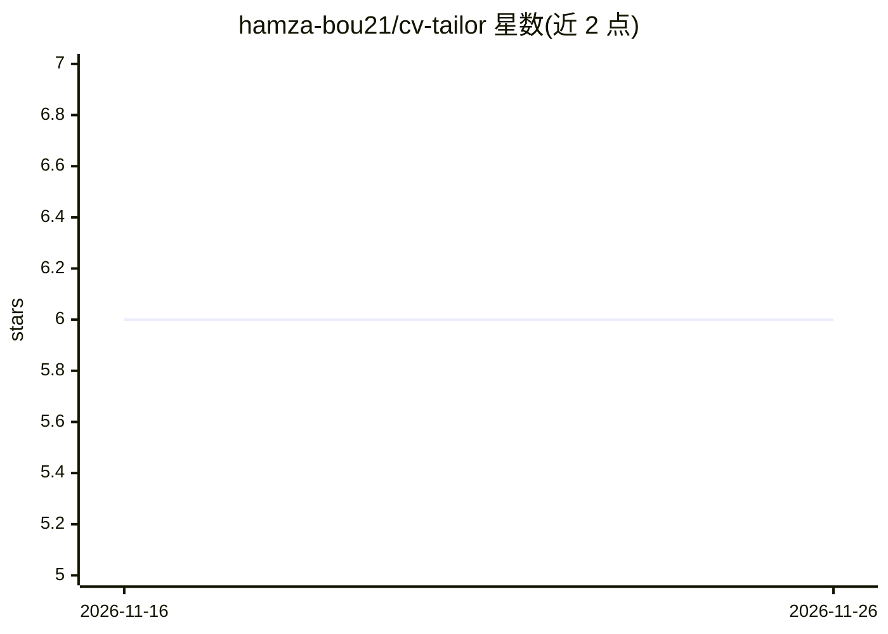

# hamza-bou21/cv-tailor

⭐ 6 · Python · MIT · 推送 2026-11-16 · [GitHub](https://github.com/hamza-bou21/cv-tailor) · 个人维护

**求职者定制简历与求职信的工具，模型只选不改**

CV Tailor 读取主 CV（PDF 提取为 master_cv.yaml）与职位描述，产出匹配度评估（0-100 分与 verdict），生成 LaTeX 编译的一页定制简历与英/法求职信。核心机制是模型仅按 ID 选择并排序既有条目，数字与技能由确定性代码（正则与集合比较）校验，失败触发重提示（最多两次重试）；每份文档记录 SHA-256 哈希存入本地 SQLite 审计库。默认通过 Groq 调用 openai/gpt-oss-120b，需 Groq API key。求职信散文由模型撰写，工具自身列出九项不保证之处。

## 筛选速览

| 维度 | 判定 | 备注 |
|---|---|---|
| AI 角色 | `ai-native` | 本体是模型或模型工具 |
| 许可风险 | `permissive` | MIT |
| 部署形态 | `self-host` | docker 或自建部署 |
| 模型依赖 | locked-api |  |
| 硬件要求 | — | 无带数字的原话,不猜 |
| 安装摩擦 | `low` | 无编译、无系统依赖或容器化 |
| 成熟度 | — | 结构信号不足 |

## 能力要点

- 模型只按 ID 选择与排序真实条目，不存在者被丢弃，遗漏者被确定性地补回
- 求职信逐句引用校验：数字与技能名用代码校验，失败自动重提示
- LaTeX 一页排版：先压缩字号间距（至 9.5pt 下限），再按排名裁剪
- 每份文档记录 SHA-256 哈希并存入本地 SQLite 审计历史

## 适用场景

- 针对具体职位生成定制的英文或法文一页简历
- 生成引用可溯源的求职信并自动校验事实性内容
- 本地保存主 CV 档案并追踪每次生成的审计记录

## 场景标签

`AI 写作` · 领域:内容生成

## 证据(README 行号)

> L5: A CV tailoring tool where the model never writes your bullet points. It only selects and ranks bullets and skills fr
> L10: CV Tailor takes a master CV and a job posting, produces a fit assessment, and generates a tailored one-page CV and 
> L40: Fit engine. Analyzes a raw job posting against `master_cv.yaml` using Groq (`openai/gpt-oss-120b` by default). Outp

## 星数曲线

2026-11-16 6 → 2026-11-26 6（+0）

---
*卡片 v1 · prompt 1.4 · 生成 2026-11-20 · 置信度 high · 依据 README sha `4b50c690f554` · [字段定义](../../DATASET.md)*
