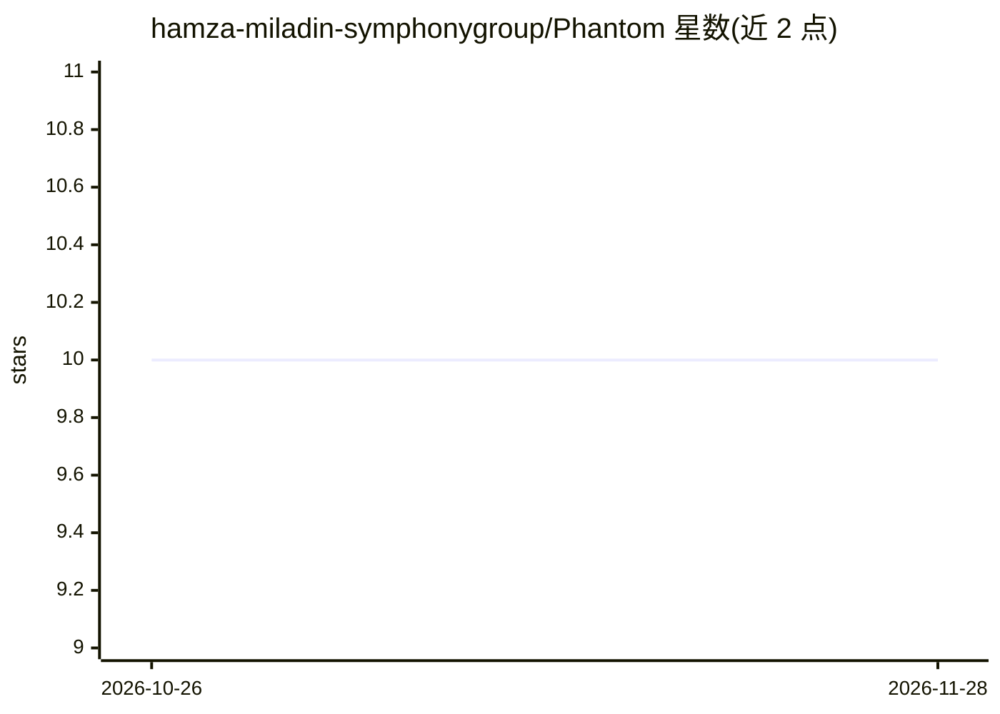

# hamza-miladin-symphonygroup/Phantom

⭐ 10 · TypeScript · MIT · 推送 2026-04-15 · [GitHub](https://github.com/hamza-miladin-symphonygroup/Phantom) · 个人维护

**开发者粘贴函数，AI 生成带解说的逐步代码执行动画**

Phantom 接收源代码并生成带解说的逐步动画解释：tree-sitter 解析 AST，Claude 分析代码概念行为并产出结构化 VisualizationIntent，规划器从手工制作的 Remotion 模板注册表中选取模板并填充参数，Zod 校验后渲染为 MP4。支持 Python、TypeScript、JavaScript、C#、Rust。LLM 不直接生成动画代码，无匹配模板时回退到通用逐步动画。Next.js Web 应用提供双栏查看器，支持步骤跳转、变速播放、变量状态展示与 AI 追问。部署需 Web、Engine、Renderer 三服务，渲染需 2GB+ 内存。

## 筛选速览

| 维度 | 判定 | 备注 |
|---|---|---|
| AI 角色 | `ai-native` | 本体是模型或模型工具 |
| 许可风险 | `permissive` | MIT |
| 部署形态 | `self-host` | docker 或自建部署 |
| 模型依赖 | locked-api |  |
| 硬件要求 | — | 无带数字的原话,不猜 |
| 安装摩擦 | `low` | 无编译、无系统依赖或容器化 |
| 成熟度 | — | 结构信号不足 |

## 能力要点

- LLM 仅做模板选择与参数填充，动画由手工 Remotion 模板承载，Zod 校验拦截幻觉输出
- 支持 Python/TypeScript/JavaScript/C#/Rust 五种语言的解析
- 查看器支持点击跳步、0.5x-2x 变速、变量状态与代码行跟踪、MP4 导出
- DEMO_MODE 可跳过 AI 调用使用本地启发式，无需 API key

## 适用场景

- 可视化理解递归、排序、动态规划等算法的执行过程
- 为学习新代码库的函数生成动画讲解
- 教学场景中展示控制流与数据结构变化

## 场景标签

 · 领域:开发者工具/教育可视化

## 证据(README 行号)

> L18: Phantom takes source code and produces narrated, step-by-step animated explanations — recursion trees unfolding, co
> L20: The LLM never generates animation code from scratch. Instead, Phantom ships **hand-crafted Remotion templates** and
> L64: **Parser** — tree-sitter extracts the AST, function signatures, control flow, and recursive patterns. Supports Pyth

## 星数曲线

2026-10-26 10 → 2026-11-28 10（+0）

---
*卡片 v1 · prompt 1.4 · 生成 2026-11-19 · 置信度 mid · 依据 README sha `0585ad55a164` · [字段定义](../../DATASET.md)*
