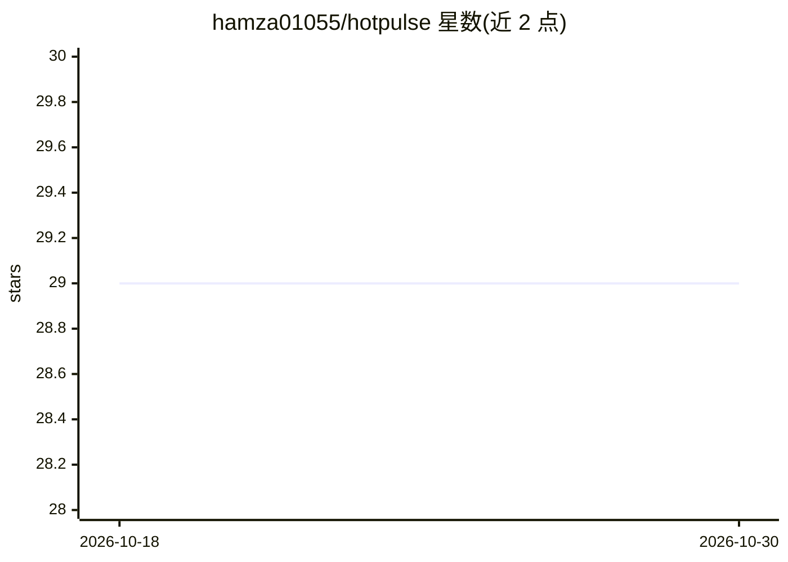

# hamza01055/hotpulse

⭐ 29 · Python · MIT · 推送 2026-10-05 · [GitHub](https://github.com/hamza01055/hotpulse) · 个人维护 · 中文 README

**自托管 AI 新闻雷达：本地 Ollama 聚合筛选新闻生成多语日报**

自托管的新闻聚合与简报生成系统：从 RSS、JSON 与招聘 API 采集新闻，去重后用本地 Ollama 模型（默认 qwen2.5:3b）做两轮评分过滤，将同一事件的多篇报道分组，按来源多样性、质量与新鲜度计算热度排名，生成含 AI 撰写导语的日/周简报、社交草稿，并通过网页、RSS、JSON API 与 MCP 端点输出。内置全球 AI、奖学金与远程岗位、巴基斯坦科技三个频道，支持十种语言与 RTL 布局，可通过 YAML 自定义频道。模型不可用时有基于关键词规则的降级路径。面向想在本地运行、不依赖付费 AI API 的个人或团队用户。

## 筛选速览

| 维度 | 判定 | 备注 |
|---|---|---|
| AI 角色 | `ai-native` | 本体是模型或模型工具 |
| 许可风险 | `permissive` | MIT |
| 部署形态 | `self-host` | docker 或自建部署 |
| 模型依赖 | local-ok | 支持本地模型 |
| 硬件要求 | — | 无带数字的原话,不猜 |
| 安装摩擦 | `low` | 无编译、无系统依赖或容器化 |
| 成熟度 | — | 结构信号不足 |

## 能力要点

- 本地 Ollama 推理，无需付费 AI API，模型不可用时关键词规则降级
- 两轮模型评分 + 事件分组 + 来源感知的热度排名
- 奖学金/岗位截止日期、资助与资格抽取（含巴基斯坦申请人适用性）
- 输出渠道覆盖网页、RSS、JSON API 与 5 个 MCP 工具

## 适用场景

- 每日自动生成聚焦 AI 领域的新闻简报供自己阅读
- 追踪奖学金、远程岗位的截止日期与申请资格
- 通过 RSS 或 MCP 客户端把新闻简报接入自己的工作流
- 自建面向特定领域（如本地科技）的自定义新闻频道

## 场景标签

 · 领域:新闻聚合/AI 内容生成

## 证据(README 行号)

> L3: **A self-hosted AI news radar powered by Ollama.**
> L31: - **Local AI with a fallback.** Use Ollama on your own machine without paid AI APIs. If the model is unavailable, k
> L38: - **Daily and weekly briefings.** Rule-based selection with an AI-written introduction. A numeric consistency check

## 星数曲线

2026-10-18 29 → 2026-10-30 29（+0）

---
*卡片 v1 · prompt 1.4 · 生成 2026-10-26 · 置信度 high · 依据 README sha `07196bab39f3` · [字段定义](../../DATASET.md)*
