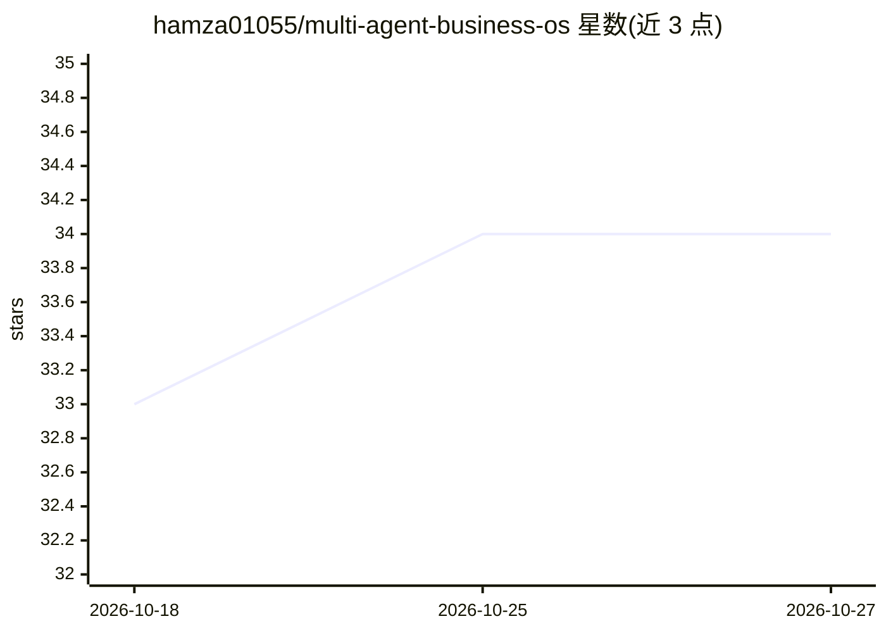

# hamza01055/multi-agent-business-os

⭐ 34 · Python · 推送 2026-10-12 · [GitHub](https://github.com/hamza01055/multi-agent-business-os) · 个人维护

**面向企业业务自动化的多智能体全栈 AI 平台**

全栈多租户 AI 平台，后端为 FastAPI + Celery + Redis + PostgreSQL，前端为 Flutter 移动应用，通过 Docker Compose 一键部署。功能覆盖 12 个模块：AI 聊天、文档/网站/YouTube 对话（RAG，FAISS/Milvus 向量存储）、Tesseract OCR 发票读取、Whisper 会议转录与摘要、LangGraph 多智能体工作流、研究报告生成与邮件助手。LLM 层可通过配置在 OpenAI 与本地 LLM 间切换，向量按工作区隔离实现多租户。

## 筛选速览

| 维度 | 判定 | 备注 |
|---|---|---|
| AI 角色 | `ai-native` | 本体是模型或模型工具 |
| 许可风险 | `permissive` | — |
| 部署形态 | `self-host` | docker 或自建部署 |
| 模型依赖 | — | README 未给出锁定关系 |
| 硬件要求 | — | 无带数字的原话,不猜 |
| 安装摩擦 | `low` | 无编译、无系统依赖或容器化 |
| 成熟度 | — | 结构信号不足 |

## 能力要点

- LangGraph supervisor 协调多 worker 智能体的多智能体工作流
- 12 个业务模块：聊天、RAG、OCR、语音、Agent、工作流等
- LLM 层 provider 无关，OpenAI 与本地 LLM 一键切换
- Docker Compose 一键部署六服务栈（Nginx/API/Worker/Postgres/Redis）

## 适用场景

- 团队搭建带权限隔离的文档问答知识库
- 批量处理发票 OCR 与会议录音转写摘要
- 用多智能体工作流自动化研究与报告撰写

## 场景标签

`多智能体` `文档问答` `语音识别` `OCR` · 领域:Agent 开发

## 证据(README 行号)

> L26: **AI Business OS** is a full-stack, multi-tenant AI platform that brings LLMs, Retrieval-Augmented Generation (RAG)
> L167: |💬 AI Chat|`/api/v1/chat`|LLM + conversational memory|

## 星数曲线

2026-10-18 33 → 2026-10-27 34（+1）

---
*卡片 v1 · prompt 1.4 · 生成 2026-10-25 · 置信度 high · 依据 README sha `2882dbd1960a` · [字段定义](../../DATASET.md)*
