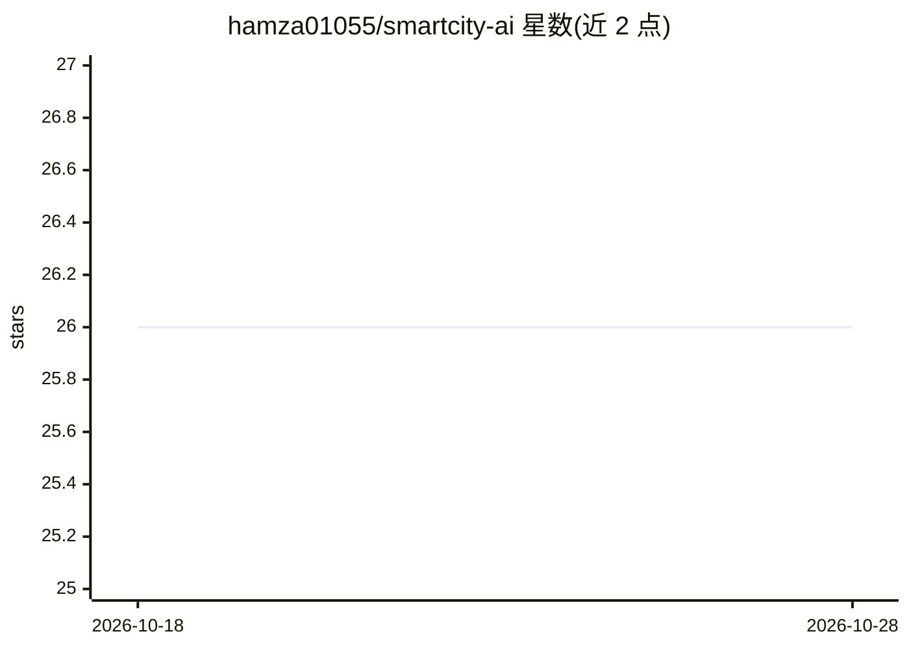

# hamza01055/smartcity-ai

⭐ 26 · Python · 推送 2026-10-27 · [GitHub](https://github.com/hamza01055/smartcity-ai) · 个人维护

**城市问题上报平台：市民拍照后 YOLOv8 自动识别分类并派单**

面向市民与市政团队的城区问题上报与处理平台：市民上传照片与 GPS 位置，自训练 YOLOv8m 模型（3 个城市问题类别，约 1500 张标注图像训练）自动识别分类，管理员在实时地图面板上指派工作人员处理。架构为 React 前端、Node.js/Express 后端、FastAPI ML 服务、Redis+BullMQ 队列、PostgreSQL/PostGIS 数据库，以 Docker Compose 6 容器部署。含分析页、工作人员门户与演示账号；项目为作者的本科毕业设计。

## 筛选速览

| 维度 | 判定 | 备注 |
|---|---|---|
| AI 角色 | `ai-native` | 本体是模型或模型工具 |
| 许可风险 | `none` | — |
| 部署形态 | `self-host` | docker 或自建部署 |
| 模型依赖 | — | README 未给出锁定关系 |
| 硬件要求 | — | 无带数字的原话,不猜 |
| 安装摩擦 | `low` | 无编译、无系统依赖或容器化 |
| 成熟度 | — | 结构信号不足 |

## 能力要点

- YOLOv8m 自定义训练 3 类城市问题检测（mAP@50 为 0.73）
- 报告→AI 分类→派单→解决的全流程角色系统（市民/管理员/工人）
- 实时地图、热力图与 KPI 分析面板
- Docker Compose 一键启动 6 个容器

## 适用场景

- 作为市民拍照上报道路坑洼、信号灯或垃圾问题并跟踪进度
- 市政管理员在地图上查看上报并指派人员处理
- 学习 YOLOv8 + FastAPI + React 的全栈 AI 应用结构

## 场景标签

`目标检测` · 领域:感知与多模态

## 证据(README 行号)

> L45: 2. **Classify** — YOLOv8 instantly identifies and categorizes the issue
> L158: |**ML Service**|Python 3.11, FastAPI, Ultralytics YOLOv8|

## 星数曲线

2026-10-18 26 → 2026-10-28 26（+0）

---
*卡片 v1 · prompt 1.4 · 生成 2026-10-26 · 置信度 high · 依据 README sha `c7c531fa4367` · [字段定义](../../DATASET.md)*
