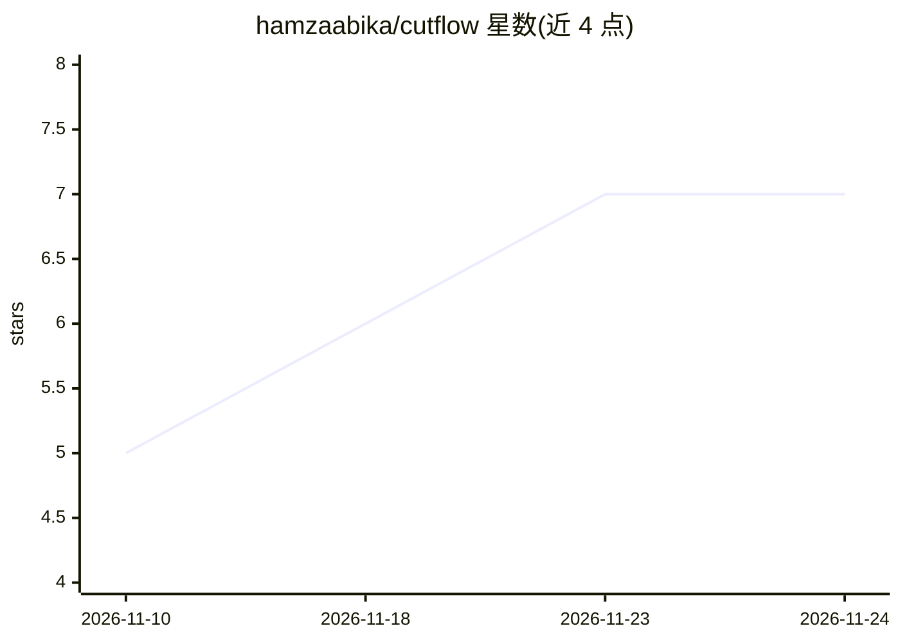

# hamzaabika/cutflow

⭐ 7 · JavaScript · MIT · 推送 2026-11-23 · [GitHub](https://github.com/hamzaabika/cutflow) · [官网](https://getcutflow.pages.dev/) · 个人维护

**免费开源的跨平台桌面视频编辑器，含 AI 助手与自动字幕**

基于 Electron + React + FFmpeg 的桌面视频编辑器，覆盖多轨时间线剪辑、135+ 转场与效果库、54 种文字模板、屏幕录制、SRT 字幕导入，支持最高 4K 导出为 MP4 或音频文件。AI 部分：本地 Whisper 离线自动字幕（含 Darija 模型）、本地 Real-ESRGAN 2x/4x 视频增强、以及使用用户自备 API key 的 FlowAI 编辑助手。全程本地运行，不上传素材；Linux/Windows/macOS 提供安装包，可从源码构建。

## 筛选速览

| 维度 | 判定 | 备注 |
|---|---|---|
| AI 角色 | `ai-enhanced` | 去掉 AI 部分产品仍成立 |
| 许可风险 | `permissive` | MIT |
| 部署形态 | `desktop` | 安装包/桌面程序 |
| 模型依赖 | local-ok | 支持本地模型 |
| 硬件要求 | — | 无带数字的原话,不猜 |
| 安装摩擦 | `medium` | 含编译或系统依赖之一 |
| 成熟度 | — | 结构信号不足 |

## 能力要点

- 本地 Whisper 离线自动字幕，含 Darija 模型
- FlowAI 助手接入用户自选 provider 与 API key（Gemini、OpenAI、Anthropic、Groq、OpenRouter、Ollama 等）
- 本地 Real-ESRGAN 2x/4x 视频增强，完全离线运行
- 135+ 转场、54 文字模板、多轨时间线与 4K 导出

## 适用场景

- 剪辑 TikTok/Reels/Shorts 竖屏短视频
- 给教程和录屏自动生成逐词字幕动画
- 离线环境下完成视频剪辑与增强而不上传素材
- 用本地模型或自有 API key 让 AI 助手代为执行剪辑操作

## 场景标签

`语音识别` `图像视频处理` · 领域:感知与多模态

## 证据(README 行号)

> L42: Cutflow is a free, open-source desktop video editor and covers what people actually open an editor for: multi-track
> L102: FlowAI is an AI editing assistant inside the editor: one-click looks, or just say what to do — cut the filler, sty
> L140: |Shell|Electron|

## 星数曲线

2026-11-10 5 → 2026-11-24 7（+2）

---
*卡片 v1 · prompt 1.4 · 生成 2026-11-21 · 置信度 high · 依据 README sha `05619d6d5d6d` · [字段定义](../../DATASET.md)*
