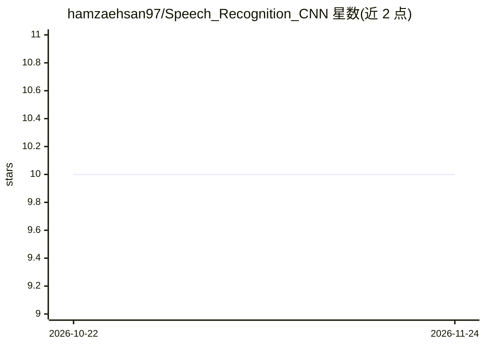

# hamzaehsan97/Speech_Recognition_CNN

⭐ 10 · Python · 推送 2026-11-15 · [GitHub](https://github.com/hamzaehsan97/Speech_Recognition_CNN) · 个人维护

**用 Keras CNN 构建语音识别模型的开发者项目**

基于 Keras/TensorFlow 构建的卷积神经网络语音识别模型项目。提供预训练模型的语音预测流程（record.py 录音后经 main.py 识别）与自定义训练流程（按词标签存放 .WAV 录音，经 audio.py 训练）。依赖 Python 3 与 wandb 进行训练可视化与运行管理，通过 git clone 获取代码后本地运行。

## 筛选速览

| 维度 | 判定 | 备注 |
|---|---|---|
| AI 角色 | `ai-native` | 本体是模型或模型工具 |
| 许可风险 | `none` | — |
| 部署形态 | `None` |  |
| 模型依赖 | — | README 未给出锁定关系 |
| 硬件要求 | — | 无带数字的原话,不猜 |
| 安装摩擦 | `low` | 无编译、无系统依赖或容器化 |
| 成熟度 | — | 结构信号不足 |

## 能力要点

- 使用 Keras 构建基于卷积神经网络的语音识别模型
- 支持使用预训练模型进行预测
- 支持用自采集的 .WAV 录音（按词标签分文件夹）训练新模型
- 集成 Wandb 进行模型训练可视化

## 适用场景

- 对约 2 秒的单词录音做语音识别预测
- 用自己录制的单词数据训练语音识别模型
- 学习 CNN 在语音识别中的应用

## 场景标签

`语音识别` · 领域:感知与多模态

## 证据(README 行号)

> L3: This project uses the keras library to build a convolutional neural network based speech recognition model.
> L28: 1) Collect recordings of the words required in .WAV format in length roughly 2 seconds.

## 星数曲线

2026-10-22 10 → 2026-11-24 10（+0）

---
*卡片 v1 · prompt 1.4 · 生成 2026-11-19 · 置信度 high · 依据 README sha `2269b9cf4f14` · [字段定义](../../DATASET.md)*
