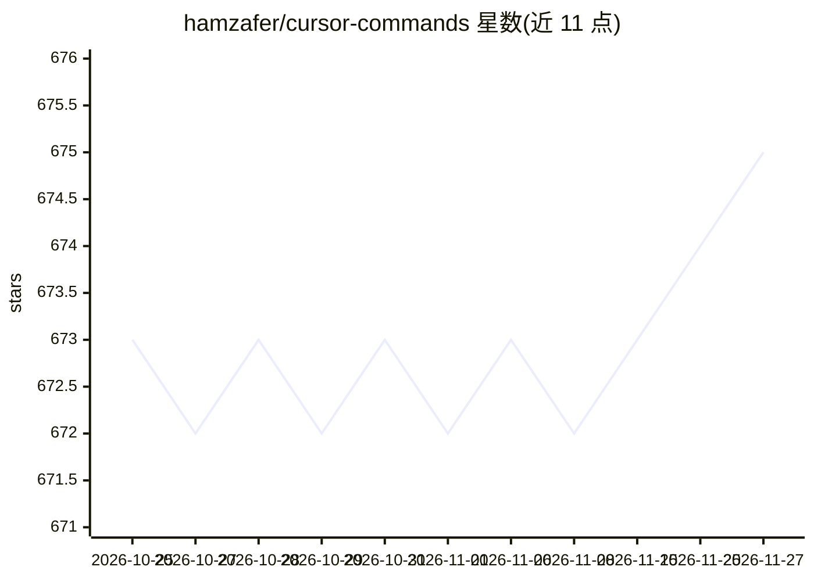

# hamzafer/cursor-commands

⭐ 675 · JavaScript · MIT · 推送 2026-11-22 · [GitHub](https://github.com/hamzafer/cursor-commands) · [官网](https://cursor.com/changelog/1-6) · 个人维护

**为 Cursor IDE 团队提供可复用、版本化的斜杠命令提示词集**

一个 Markdown 文件形式的 Cursor 自定义斜杠命令集合：将提示词存放在项目的 .cursor/commands/ 或全局 ~/.cursor/commands/ 目录，用户在 Cursor 聊天/agent 输入框键入 / 即可列出并插入执行。命令按代码质量、评审协作、测试、文档、安全/无障碍/基础设施、Git 工作流等类别组织，覆盖 lint 修复、代码评审、PR 描述生成、单元测试编写、安全审计、Mermaid 图生成、数据库迁移等场景；命令可随仓库通过 git 共享，支持自行编写新命令。另附少量 Claude Code 技能。

## 筛选速览

| 维度 | 判定 | 备注 |
|---|---|---|
| AI 角色 | `ai-knowledge` | 知识聚合/清单类 |
| 许可风险 | `permissive` | MIT |
| 部署形态 | `None` |  |
| 模型依赖 | — | README 未给出锁定关系 |
| 硬件要求 | — | 无带数字的原话,不猜 |
| 安装摩擦 | `low` | 无编译、无系统依赖或容器化 |
| 成熟度 | — | 结构信号不足 |

## 能力要点

- 约 30 个分类组织的斜杠命令 Markdown 文件，随仓库版本控制共享
- 支持项目级 .cursor/commands/ 与全局 ~/.cursor/commands/ 两种存放位置
- 覆盖 lint/评审/测试/文档/安全审计/Git 提交推送等团队工作流
- 附带 Claude Code 技能目录（复制到 ~/.claude/skills/ 安装）

## 适用场景

- 团队在 Cursor 中统一代码评审与 PR 流程的提示词
- 一键运行测试套件并修复失败项
- 为代码生成 API 文档与 Mermaid 架构图
- 对代码变更做安全与 WCAG 无障碍检查

## 场景标签

`提示工程` `代码审查` · 领域:Agent 开发

## 证据(README 行号)

> L5: A curated collection of Cursor slash-command prompts that give your team
> L12: Cursor Commands are reusable AI prompts saved as Markdown files in
> L58: ## Available commands

## 星数曲线

2026-10-25 673 → 2026-11-27 675（+2）

---
*卡片 v1 · prompt 1.4 · 生成 2026-11-24 · 置信度 high · 依据 README sha `9e2076765669` · [字段定义](../../DATASET.md)*
