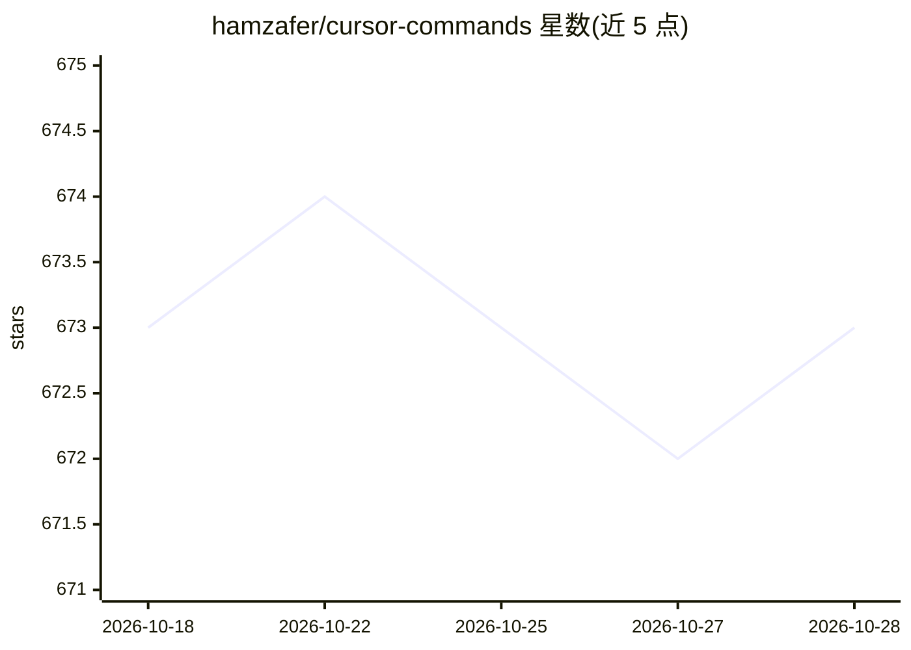

# hamzafer/cursor-commands

⭐ 673 · MIT · 推送 2026-04-07 · [GitHub](https://github.com/hamzafer/cursor-commands) · [官网](https://cursor.com/changelog/1-6) · 个人维护

**Cursor IDE 的斜杠命令提示词集合，供团队复用 AI 工作流**

以 Markdown 文件形式组织的 Cursor 自定义斜杠命令库：放入 .cursor/commands/ 目录后，在 Cursor 聊天输入 / 即可列出并插入提示词。命令分为项目级与全局级两种存放方式，可通过 git 随仓库共享。收录约 30 个命令，覆盖代码质量、PR 审查、测试调试、文档生成、安全审计、Git 工作流等类别；用户可参照现有文件自行编写命令。安装方式为克隆仓库或复制目录，需在 Cursor IDE 中使用。

## 筛选速览

| 维度 | 判定 | 备注 |
|---|---|---|
| AI 角色 | `ai-knowledge` | 知识聚合/清单类 |
| 许可风险 | `permissive` | MIT |
| 部署形态 | `None` |  |
| 模型依赖 | — | README 未给出锁定关系 |
| 硬件要求 | — | 无带数字的原话,不猜 |
| 安装摩擦 | `low` | 无编译、无系统依赖或容器化 |
| 成熟度 | — | 结构信号不足 |

## 能力要点

- 约 30 个现成斜杠命令，覆盖代码审查/测试/文档/安全审计/Git 等类别
- 命令以 Markdown 文件存放，支持项目级与全局级两种位置
- 可随 git 仓库在团队间共享，统一提示词标准
- 提供自行编写自定义命令的模板与最佳实践

## 适用场景

- 团队统一定义代码审查、提交信息等 AI 工作流提示词
- 在 Cursor 中通过 / 快速调用常用 AI 任务
- 为新成员提供按清单驱动的入职与开发流程命令

## 场景标签

`提示工程` · 领域:Agent 开发

## 证据(README 行号)

> L5: A curated collection of Cursor slash-command prompts that give your team
> L12: Cursor Commands are reusable AI prompts saved as Markdown files in

## 星数曲线

2026-10-18 673 → 2026-10-28 673（+0）

---
*卡片 v1 · prompt 1.4 · 生成 2026-10-21 · 置信度 high · 依据 README sha `fc1629b430fd` · [字段定义](../../DATASET.md)*
