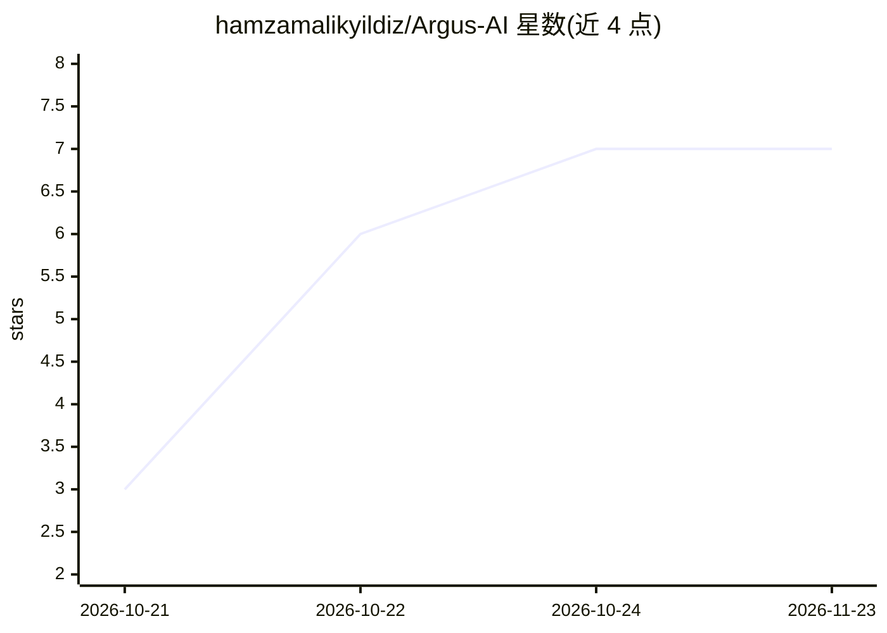

# hamzamalikyildiz/Argus-AI

⭐ 7 · Python · MIT · 推送 2026-11-19 · [GitHub](https://github.com/hamzamalikyildiz/Argus-AI) · 个人维护

**多 Agent 自动化 AI 情报简报生成系统：每日抓取、评分、分析并归档**

基于 LangGraph 的确定性流水线：每天自动从 RSS 源、ArXiv API 与 HF Papers 抓取内容，经 Curator 与 Analyst 两级 Agent 打分与深度分析，生成报告后由 Auditor Agent 审核链接完整性与 Markdown 格式并自动修复，可经 Broadcaster Agent 向 Telegram 推送摘要。支持 Gemini/OpenAI 双 LLM 经环境变量切换，报告语言可选土耳其语或英语，通过 GitHub Actions 每日定时运行并提交归档到仓库。需配置 API key。

## 筛选速览

| 维度 | 判定 | 备注 |
|---|---|---|
| AI 角色 | `ai-native` | 本体是模型或模型工具 |
| 许可风险 | `permissive` | MIT |
| 部署形态 | `None` |  |
| 模型依赖 | — | README 未给出锁定关系 |
| 硬件要求 | — | 无带数字的原话,不猜 |
| 安装摩擦 | `low` | 无编译、无系统依赖或容器化 |
| 成熟度 | — | 结构信号不足 |

## 能力要点

- Curator/Analyst/Auditor/Broadcaster 多 Agent 分层架构（LangGraph 编排）
- LLM_PROVIDER 单变量切换 Gemini 与 OpenAI
- 报告链接直接来自 Ingestion 层真实 URL
- GitHub Actions 每日 UTC 04:00 自动运行并归档，支持 Telegram 推送

## 适用场景

- 每天自动生成 AI 领域新闻与论文的情报简报
- 把简报自动推送到 Telegram 频道
- 在 GitHub 仓库中长期归档和检索历史简报

## 场景标签

`多智能体` · 领域:Agent 开发

## 证据(README 行号)

> L7: > *Yunan mitolojisinde asla uyumayan ve her şeyi gören Argus'tan esinlenen; Deterministik LangGraph tabanlı, her gün
> L20: - **Çift LLM Desteği**: Hem Google Gemini hem de OpenAI ile tam uyumlu; `.env` üzerinden tek değişkenle geçiş (`LLM
> L21: - **Kademeli Model Mimarisi**:

## 星数曲线

2026-10-21 3 → 2026-11-23 7（+4）

---
*卡片 v1 · prompt 1.4 · 生成 2026-11-20 · 置信度 high · 依据 README sha `8b9b483ddd6c` · [字段定义](../../DATASET.md)*
