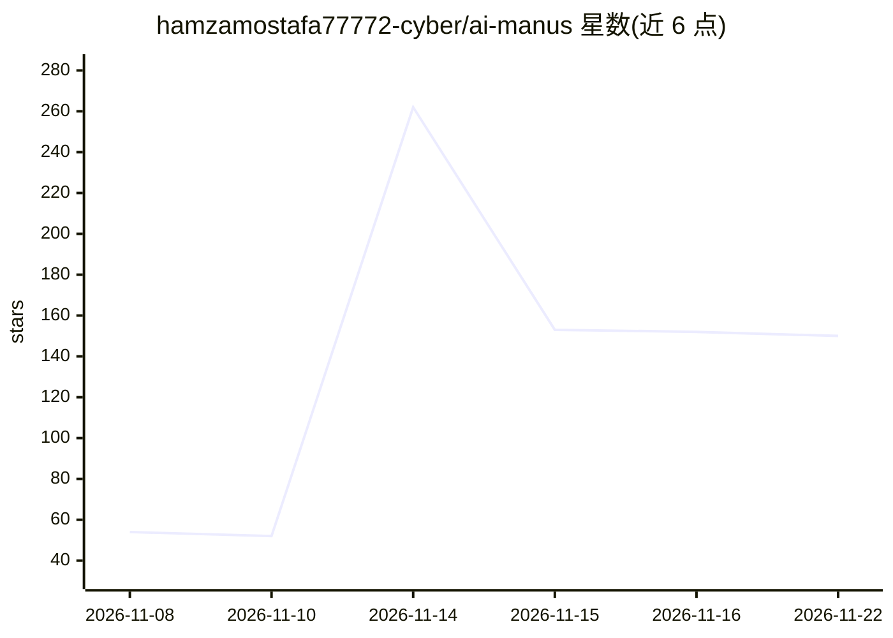

# hamzamostafa77772-cyber/ai-manus

⭐ 150 · Python · Apache-2.0 · 推送 2026-11-14 · [GitHub](https://github.com/hamzamostafa77772-cyber/ai-manus) · 个人维护

**面向日常任务的自主 AI Agent：代写执行代码、控制浏览器**

Manus 是一个自主运行的 AI agent，在沙箱环境中执行代码并控制浏览器：可自行编写和运行脚本、打开网页、填写表单、完成多步任务，代码执行与浏览器操作可在同一流程内衔接。定位为家庭、学习与小规模轻量任务的个人助手，非企业级平台。README 给出硬件兼容表（最低双核 CPU、4GB 内存），并列出下载入口与使用步骤，但未提供具体的安装命令、技术架构或模型接入说明。

## 筛选速览

| 维度 | 判定 | 备注 |
|---|---|---|
| AI 角色 | `ai-native` | 本体是模型或模型工具 |
| 许可风险 | `permissive` | Apache-2.0 |
| 部署形态 | `None` |  |
| 模型依赖 | — | README 未给出锁定关系 |
| 硬件要求 | — | 无带数字的原话,不猜 |
| 安装摩擦 | `low` | 无编译、无系统依赖或容器化 |
| 成熟度 | — | 结构信号不足 |

## 能力要点

- 自主代码执行：agent 自行编写并运行脚本完成任务
- 浏览器控制：导航网页、填写表单、收集信息
- 代码与浏览器操作在同一工作流中衔接
- 面向家庭/学习/轻量办公场景的多步任务自动化

## 适用场景

- 让 agent 代为跑脚本和检查网页信息，减少重复操作
- 学习研究中整理笔记、收集参考资料
- 轻量办公中汇总多个页面的信息准备摘要
- 远程支持中重排诊断步骤、检查系统页面

## 场景标签

`工作流自动化` `AI 助手` `浏览器自动化` · 领域:效率与自动化

## 证据(README 行号)

> L10: - **Autonomous Code Execution:** Manus AI agent runs code on its own to complete tasks, so you can focus on decisio
> L18: Manus is an autonomous AI agent designed to run code and control a browser on your behalf. Instead of acting like a
> L22: Manus is not a heavy studio suite or a complex enterprise platform. It is a focused helper built for home, study, a

## 星数曲线

2026-11-08 54 → 2026-11-22 150（+96）

---
*卡片 v1 · prompt 1.4 · 生成 2026-11-17 · 置信度 mid · 依据 README sha `d34fa8aaddca` · [字段定义](../../DATASET.md)*
