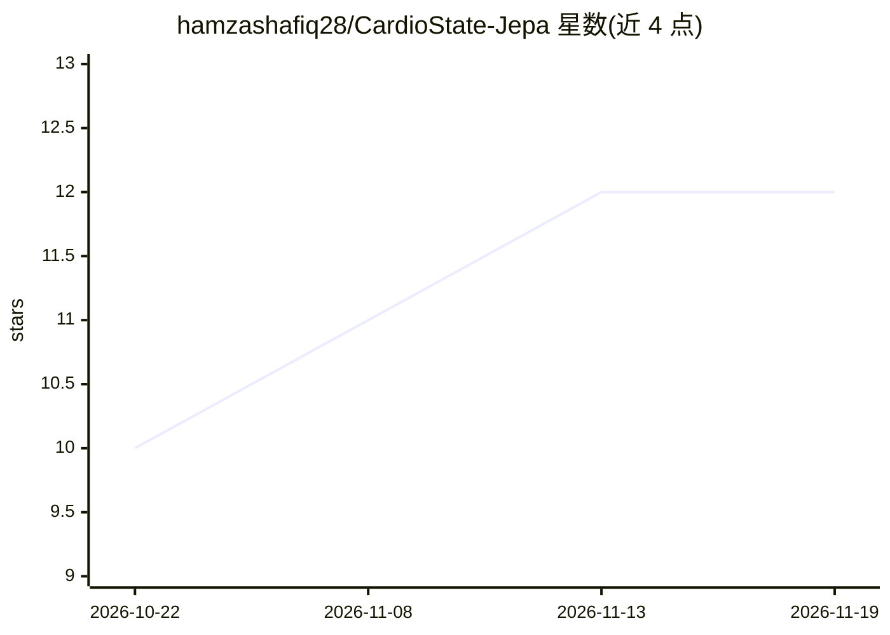

# hamzashafiq28/CardioState-Jepa

⭐ 12 · Python · 推送 2026-08-14 · [GitHub](https://github.com/hamzashafiq28/CardioState-Jepa) · 个人维护

**为心血管研究者提供跨 ECG/PPG/PCG 的共享预训练编码器**

基于 JEPA 的心脏基础模型：用单个共享 Transformer 编码器将 ECG、PPG、PCG 三种波形映射到公共 token 空间，通过延迟对齐器处理模态间生理时差，并以预测掩码潜在状态的方式预训练。训练分两阶段：先从大量单模态数据学习模态内结构，再用配对数据在潜在心脏时间轴上对齐。仓库发布预训练编码器权重（ViT-B，约 360 MB）与线性探针评估框架，支持以冻结编码器方式复现 25 个下游任务的结果，权重兼容 Hugging Face transformers 接口加载。

## 筛选速览

| 维度 | 判定 | 备注 |
|---|---|---|
| AI 角色 | `ai-native` | 本体是模型或模型工具 |
| 许可风险 | `none` | — |
| 部署形态 | `library` | 以包/库形式分发 |
| 模型依赖 | — | README 未给出锁定关系 |
| 硬件要求 | — | 无带数字的原话,不猜 |
| 安装摩擦 | `low` | 无编译、无系统依赖或容器化 |
| 成熟度 | — | 结构信号不足 |

## 能力要点

- 单一共享 Transformer 编码器联合处理 ECG/PPG/PCG 三模态
- 延迟感知跨模态预测与两阶段预训练课程
- 发布约 360 MB 纯权重 checkpoint 并兼容 transformers AutoModel 加载
- 附带冻结编码器线性探针评估框架，覆盖 25 个下游任务

## 适用场景

- 在 ECG/PPG/PCG 分类或回归任务上提取冻结编码特征做下游评估
- 复现论文中 25 个下游基准任务的线性探针结果
- 基于共享心脏表征开展跨模态生理信号研究

## 场景标签

`模型训练` `模型评测` · 领域:评测与运维

## 证据(README 行号)

> L14: **CardioState-JEPA** is a cardiac foundation model that learns **one shared representation
> L35: This repository releases the **pretrained shared encoder** and a **linear-probe evaluation
> L29: Evaluated as a **frozen encoder** across **25 downstream tasks** spanning ECG, PPG, and PCG,

## 星数曲线

2026-10-22 10 → 2026-11-19 12（+2）

---
*卡片 v1 · prompt 1.4 · 生成 2026-11-18 · 置信度 high · 依据 README sha `7091d2616b3c` · [字段定义](../../DATASET.md)*
