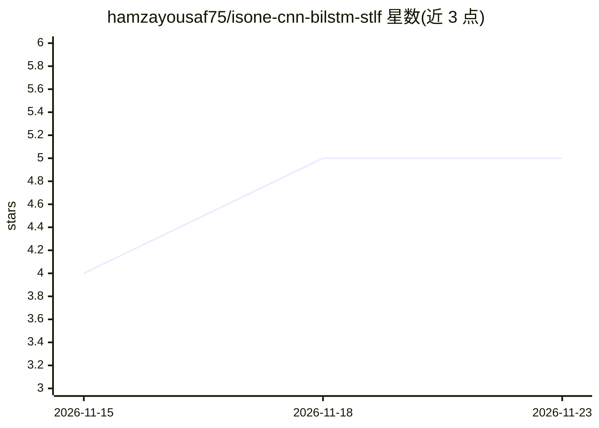

# hamzayousaf75/isone-cnn-bilstm-stlf

⭐ 5 · Python · MIT · 推送 2026-11-15 · [GitHub](https://github.com/hamzayousaf75/isone-cnn-bilstm-stlf) · 个人维护

**面向科研的 CNN-BiLSTM 短期电力负荷预测模型实现**

混合 1D-CNN 与双向 LSTM 的短期电力负荷预测模型官方实现，在 ISO New England 2019–2023 数据集（43,824 小时观测）上复现论文结果。架构含 168 小时回看窗口的卷积特征提取、双向 LSTM 时序建模、自回归-日前市场残差通路，以及两阶段学习率训练计划。README 提供数据集统计、24 小时多步与单步预测结果表、可视化图表，并附 ICECCE 2026 论文引用信息；通过 requirements.txt 安装依赖后运行单一 Python 脚本即可复现。

## 筛选速览

| 维度 | 判定 | 备注 |
|---|---|---|
| AI 角色 | `ai-native` | 本体是模型或模型工具 |
| 许可风险 | `permissive` | MIT |
| 部署形态 | `library` | 以包/库形式分发 |
| 模型依赖 | — | README 未给出锁定关系 |
| 硬件要求 | — | 无带数字的原话,不猜 |
| 安装摩擦 | `low` | 无编译、无系统依赖或容器化 |
| 成熟度 | — | 结构信号不足 |

## 能力要点

- 1D-CNN（168 小时回看窗口）+ 双向 LSTM + 残差高速公路的混合架构
- 两阶段优化：粗训练（lr=1e-3，25 epochs）与微调（lr=1e-4，15 epochs）加早停
- 基于 ISO-NE 2019–2023 官方 SMD 数据（43,824 小时，0 缺失值）
- 提供 24 小时多步与单步预测的对比结果表与收敛曲线

## 适用场景

- 复现论文中的电力负荷预测实验结果
- 在 ISO-NE 数据集上训练短期负荷预测模型
- 作为时间序列深度学习模型的学习参考实现

## 场景标签

`科研工具` · 领域:学习与行业

## 证据(README 行号)

> L3: Official implementation and empirical reproduction for **Hybrid 1D-CNN and Bidirectional LSTM (CNN-BiLSTM)** short-t
> L68: This repository provides the official open-source implementation and benchmark dataset for our paper accepted at th

## 星数曲线

2026-11-15 4 → 2026-11-23 5（+1）

---
*卡片 v1 · prompt 1.4 · 生成 2026-11-21 · 置信度 high · 依据 README sha `7861833e4f4e` · [字段定义](../../DATASET.md)*
