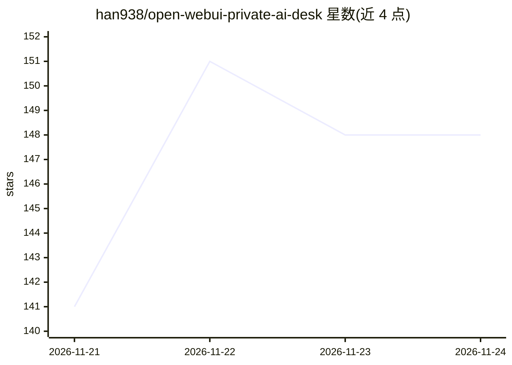

# han938/open-webui-private-ai-desk

⭐ 148 · TypeScript · 推送 2026-11-22 · [GitHub](https://github.com/han938/open-webui-private-ai-desk) · 个人维护

**本地自托管私有 AI 工作台：聊天、文档问答与模型管理**

面向团队与个人的自托管 AI 工作区应用，将聊天界面、文档交互与模型管理整合在同一界面中，宣称全程运行在用户自有基础设施上，数据不出本地环境。功能覆盖会话历史与分组管理、按会话挂载参考文档的问答（支持显示引用来源）、系统指令与回复长度控制、多用户账号与权限管理、数据保留策略设置等。运行环境限定 Windows 10/11，通过 PowerShell 脚本安装。

## 筛选速览

| 维度 | 判定 | 备注 |
|---|---|---|
| AI 角色 | `ai-native` | 本体是模型或模型工具 |
| 许可风险 | `none` | — |
| 部署形态 | `None` |  |
| 模型依赖 | — | README 未给出锁定关系 |
| 硬件要求 | — | 无带数字的原话,不猜 |
| 安装摩擦 | `low` | 无编译、无系统依赖或容器化 |
| 成熟度 | — | 结构信号不足 |

## 能力要点

- 本地私有部署：会话、文档与模型交互保留在自有基础设施内
- 文档感知问答：按会话挂载参考材料，支持显示检索片段或引用来源
- 多用户管理：管理员账号、会话归属与数据保留期限设置
- 每会话模型选择器，可在多个已配置模型或后端端点间切换

## 适用场景

- 合规人员基于内部手册起草政策文档并核对引用来源
- 小团队对比两个私有模型端点对同一问题的回答
- 管理员为同事搭建多用户私有桌面并设置会话保留期

## 场景标签

`聊天机器人` `文档问答` · 领域:对话与助手

## 证据(README 行号)

> L12: Open Webui Private Ai Desk is a self-contained AI workspace built for teams and individuals who want the power of m
> L29: - **Document-aware assistance**: Bring files into the conversation and let the desk reason over your documents for 
> L64: - A per-chat model selector lets users pick among configured models or private backend endpoints and see responses 

## 星数曲线

2026-11-21 141 → 2026-11-24 148（+7）

---
*卡片 v1 · prompt 1.4 · 生成 2026-11-21 · 置信度 mid · 依据 README sha `b00bf4dce151` · [字段定义](../../DATASET.md)*
