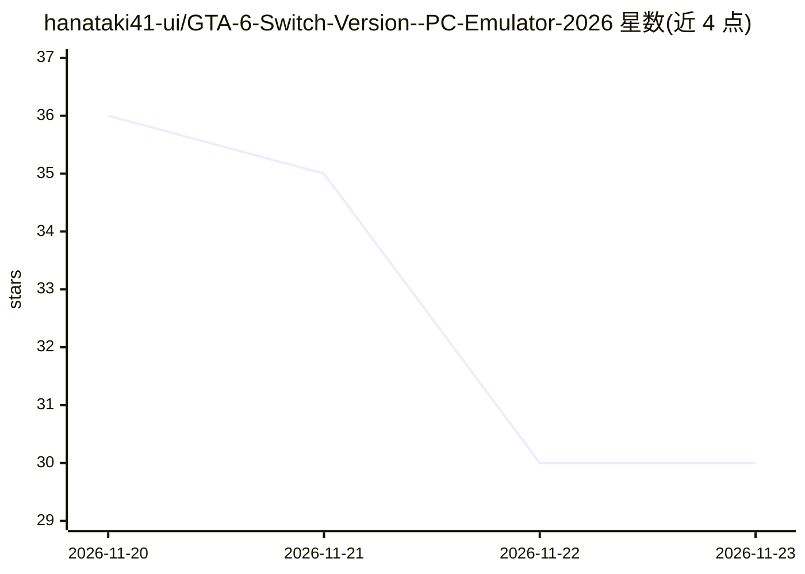

# hanataki41-ui/GTA-6-Switch-Version--PC-Emulator-2026

⭐ 30 · Rust · Apache-2.0 · 推送 2026-11-21 · [GitHub](https://github.com/hanataki41-ui/GTA-6-Switch-Version--PC-Emulator-2026) · 个人维护

**面向 Windows 用户的 GTA VI PC 版安装与配置指南资源**

为尚未发布 PC 版的《侠盗猎车手 VI》提供 Windows 安装与准备内容：涵盖系统更新、GPU 驱动配置、存储检查、Rockstar Games Launcher 准备、图形与 FPS 优化建议、安装故障排查与 FAQ。自带一个不含游戏文件的 Windows 安装包（.exe）作为设置配套工具。README 明确 PC 版发布日期与官方硬件要求均未公布，多处内容标注待官方信息发布后补充。面向的读者是等待 GTA VI PC 版的 Windows 玩家。

## 筛选速览

| 维度 | 判定 | 备注 |
|---|---|---|
| AI 角色 | `ai-knowledge` | 知识聚合/清单类 |
| 许可风险 | `permissive` | Apache-2.0 |
| 部署形态 | `desktop` | 安装包/桌面程序 |
| 模型依赖 | — | README 未给出锁定关系 |
| 硬件要求 | — | 无带数字的原话,不猜 |
| 安装摩擦 | `low` | 无编译、无系统依赖或容器化 |
| 成熟度 | `idea` | |

## 能力要点

- 提供 Windows 准备、驱动、存储与 Launcher 配置的分步指南
- 覆盖图形设置、FPS 优化与安装故障排查类别
- 自带不含 GTA VI 游戏文件的 Windows 设置配套安装包（.exe）
- 官方系统要求表格当前全部标注未确认

## 适用场景

- GTA VI PC 版发布前提前准备 Windows 环境与驱动
- 排查 PC 游戏常见的低 FPS、卡顿与安装错误
- 了解 GTA VI PC 版已知发布信息与官方资源链接

## 场景标签

 · 领域:游戏/安装配置指南

## 证据(README 行号)

> L3: ### GTA 6 PC Installation, Setup & Performance Guide
> L5: A dedicated PC installation and configuration resource for Grand Theft Auto VI, covering Windows preparation, graphi
> L19: The installation resource focuses on:

## 星数曲线

2026-11-20 36 → 2026-11-23 30（-6）

---
*卡片 v1 · prompt 1.4 · 生成 2026-11-22 · 置信度 mid · 依据 README sha `2fe487426686` · [字段定义](../../DATASET.md)*
