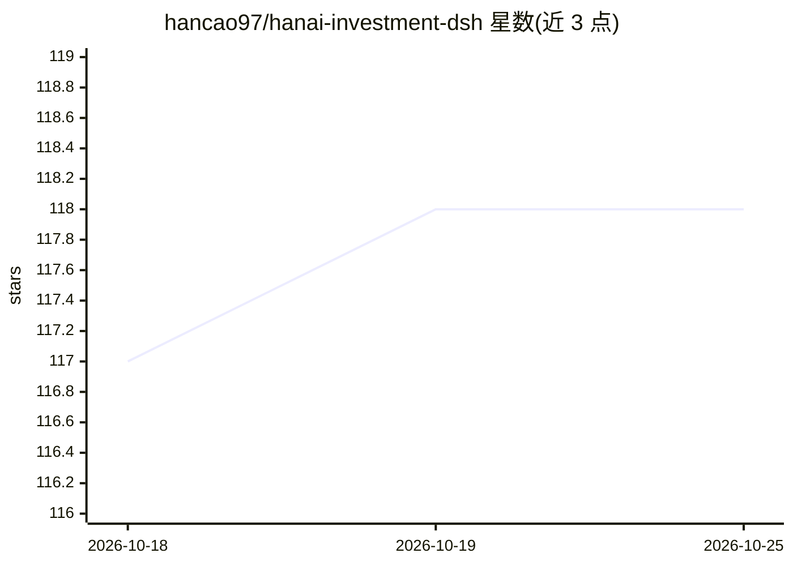

# hancao97/hanai-investment-dsh

⭐ 118 · TypeScript · MIT · 推送 2026-10-18 · [GitHub](https://github.com/hancao97/hanai-investment-dsh) · 个人维护 · 中文 README

**以 DeepSeek Harness 为内核的本地 A 股投研工作台**

基于 React 18 的本地优先 A 股研究插件（DSH Profile），面向个人投资者。提供市场全景、自选估值、多周期 K 线与十类量价变盘点标记（确定性计算，不调用大模型）、大师方法论研判与专家开放对谈（六七位专家视角）、不可变版本化报告与持续追问。DSH 负责 Agent、模型与 Session 持久化，Hanai 只存自选、索引与报告快照于本地 SQLite。运行需 Node.js、pnpm、DSH 0.2.1-rc.2 与 DeepSeek API Key；仅看行情与自选无需 Key。

## 筛选速览

| 维度 | 判定 | 备注 |
|---|---|---|
| AI 角色 | `ai-native` | 本体是模型或模型工具 |
| 许可风险 | `permissive` | MIT |
| 部署形态 | `library` | 以包/库形式分发 |
| 模型依赖 | locked-api |  |
| 硬件要求 | — | 无带数字的原话,不猜 |
| 安装摩擦 | `low` | 无编译、无系统依赖或容器化 |
| 成熟度 | — | 结构信号不足 |

## 能力要点

- 十类量价变盘点标记为确定性计算，相同 K 线输入必得相同标记
- 大师研判产出不可变版本化 Markdown 报告并支持沿用原 Session 持续追问
- 全市场回测对 16 个冻结规则做匹配对照与多重校正，本轮 0/16 通过上线门槛
- 业务数据（自选、报告、会话索引）默认写入本地 ~/.hanai-investment-dsh

## 适用场景

- 浏览 A 股市场全景、自选行情与估值并跟踪个股 K 线观察标记
- 让 AI 专家按大师方法论生成个股研判报告并持续追问验证
- 不选股票直接与专家视角开放对谈行业周期与商业模式

## 场景标签

`金融量化` · 领域:学习与行业

## 证据(README 行号)

> L12: **Hanai Worth · 值见** 是以 DeepSeek Harness 为 Agent 内核的本地优先 A 股研究工作台。它把市场全景、自选估值、个股行情与 K 线观察、大师方法论研判、专家开放对谈、报告归档和持续追问放
> L14: DeepSeek Harness（DSH）负责模型、Agent、工具、Session、流式事件和会话持久化；Hanai Worth 负责证券与估值数据、自选分组、研究资料、不可变报告快照和全部产品界面。产品包含“今日市场、自选与发

## 星数曲线

2026-10-18 117 → 2026-10-25 118（+1）

---
*卡片 v1 · prompt 1.4 · 生成 2026-10-23 · 置信度 high · 依据 README sha `31830f86b9b4` · [字段定义](../../DATASET.md)*
