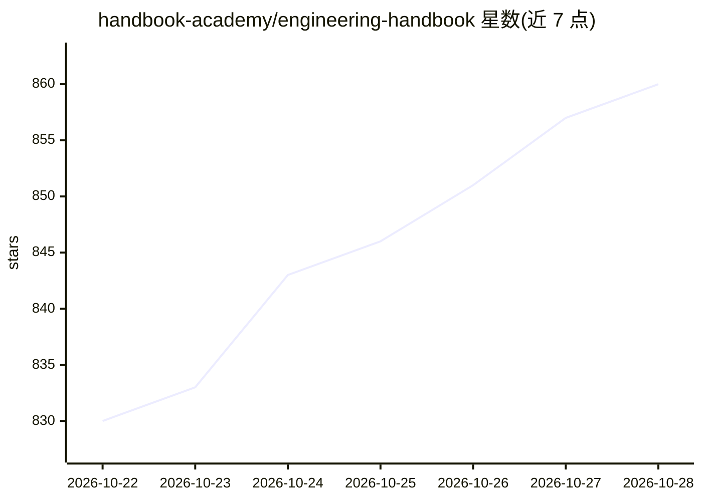

# handbook-academy/engineering-handbook

⭐ 860 · JavaScript · CC-BY-SA-4.0 · 推送 2026-10-26 · [GitHub](https://github.com/handbook-academy/engineering-handbook) · [官网](https://handbook.academy) · 组织维护

**免费开源的软件工程教科书套装：系统设计/DSA/AI 工程**

由 Handbook Academy 维护的三本开放教科书：HLD（系统设计，含分布式系统、架构、安全与 AI 系统设计）、DSA（按模式组织的数据结构与算法，Python 为主兼 Java/C++/Go）、AI Engineering（基于模型 API 构建生产 AI 产品：提示词、评测、检索、Agent、可观测性、成本）。内容以纯 Markdown 存放于仓库，同步渲染到 handbook.academy 网站，全部 CC BY-SA 4.0 许可，章节含图示、实例、生产注意事项与脚注引文，并记录更新时间。面向求职面试者、进阶工程师、AI 功能开发者与自学者，无需安装即可在线阅读，接受 PR 贡献。

## 筛选速览

| 维度 | 判定 | 备注 |
|---|---|---|
| AI 角色 | `ai-knowledge` | 知识聚合/清单类 |
| 许可风险 | `viral` | CC-BY-SA-4.0 |
| 部署形态 | `None` |  |
| 模型依赖 | — | README 未给出锁定关系 |
| 硬件要求 | — | 无带数字的原话,不猜 |
| 安装摩擦 | `low` | 无编译、无系统依赖或容器化 |
| 成熟度 | — | 结构信号不足 |

## 能力要点

- 三本教科书覆盖系统设计/DSA/AI 工程，共 30+ 主题分区
- 纯 Markdown 源文件 + 同步网站，CC BY-SA 4.0 免费阅读
- 章节含图示、工程实例、权衡分析与生产注意事项
- AI 工程卷覆盖提示词、评测、检索、Agent、可观测性与成本

## 适用场景

- 准备系统设计与编码面试，按学习计划刷完整课程
- 构建 LLM 功能时学习评测、检索与可观测性实践
- 自学补齐计算机科学基础（网络/OS/数据库）

## 场景标签

`教程课程` · 领域:学习与行业

## 证据(README 行号)

> L21: The Engineering Handbook is a set of free textbooks for software engineers. Each book is a complete course: every t
> L39: |**AI Engineering Handbook**|How to build and run production AI products on top of model APIs: prompts, evals, cont

## 星数曲线

2026-10-22 830 → 2026-10-28 860（+30）

---
*卡片 v1 · prompt 1.4 · 生成 2026-10-21 · 置信度 high · 依据 README sha `77f6b4f7da4b` · [字段定义](../../DATASET.md)*
