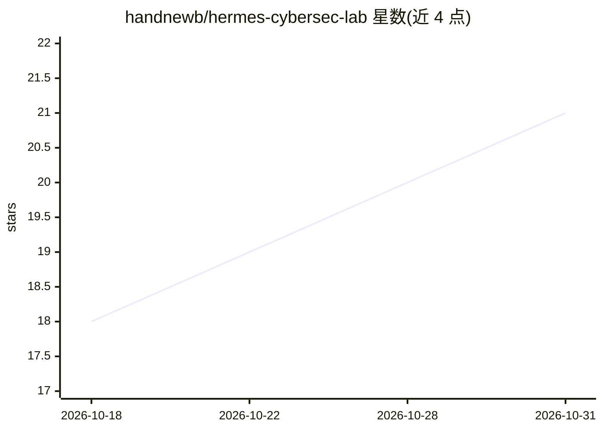

# handnewb/hermes-cybersec-lab

⭐ 21 · Shell · MIT · 推送 2026-08-11 · [GitHub](https://github.com/handnewb/hermes-cybersec-lab) · [官网](https://github.com/handnewb/hermes-cybersec-lab) · 个人维护

**面向 Hermes Agent 的网络安全技能与工具一体化实验室**

为 Hermes Agent 提供的开箱即用网络安全生态系统：核心仓库内置 382 个技能（宣称共 2,077 个，分布于 7 个外部仓库），通过 install.sh 安装 131+ 安全工具，覆盖网络侦察、漏洞利用、取证、CTI/OSINT 等类别，并整合 MITRE ATT&CK、OWASP、NIST 等 28 个框架与标准。加载后 Agent 获得技能与工具清单感知、结构化方法论（侦察→扫描→利用→取证→CTI→报告）以及经验积累机制。通过 git clone 获取，脚本一键克隆外部仓库并安装工具。

## 筛选速览

| 维度 | 判定 | 备注 |
|---|---|---|
| AI 角色 | `ai-knowledge` | 知识聚合/清单类 |
| 许可风险 | `permissive` | MIT |
| 部署形态 | `None` |  |
| 模型依赖 | — | README 未给出锁定关系 |
| 硬件要求 | — | 无带数字的原话,不猜 |
| 安装摩擦 | `low` | 无编译、无系统依赖或容器化 |
| 成熟度 | — | 结构信号不足 |

## 能力要点

- 内置 382 个安全技能，聚合 7 个外部仓库共 2,077 个技能
- install.sh 一键安装 131+ 工具，覆盖 7 个阶段
- 整合 MITRE ATT&CK/OWASP/NIST 等 28 个框架与标准
- 结构化渗透方法论与 findings.md 知识积累机制

## 适用场景

- 为 Hermes Agent 搭建覆盖渗透测试与取证的完整安全工具环境
- 安全研究、威胁狩猎与威胁情报工作的方法论参考
- 按 16 个领域查找可复用的网络安全 agent 技能

## 场景标签

`网络安全` · 领域:学习与行业

## 证据(README 行号)

> L3: **Turnkey cybersecurity ecosystem for Hermes Agent** — **2,077 skills**, **131+ tools**, **28 frameworks** across 8 
> L9: |**Skills**|**2,077**|397 embedded + 1,680 across 7 external repos|
> L53: - **Full ecosystem awareness** — knows all 2,077 skills and which external repo holds each one

## 星数曲线

2026-10-18 18 → 2026-10-31 21（+3）

---
*卡片 v1 · prompt 1.4 · 生成 2026-10-28 · 置信度 high · 依据 README sha `e895e417c491` · [字段定义](../../DATASET.md)*
