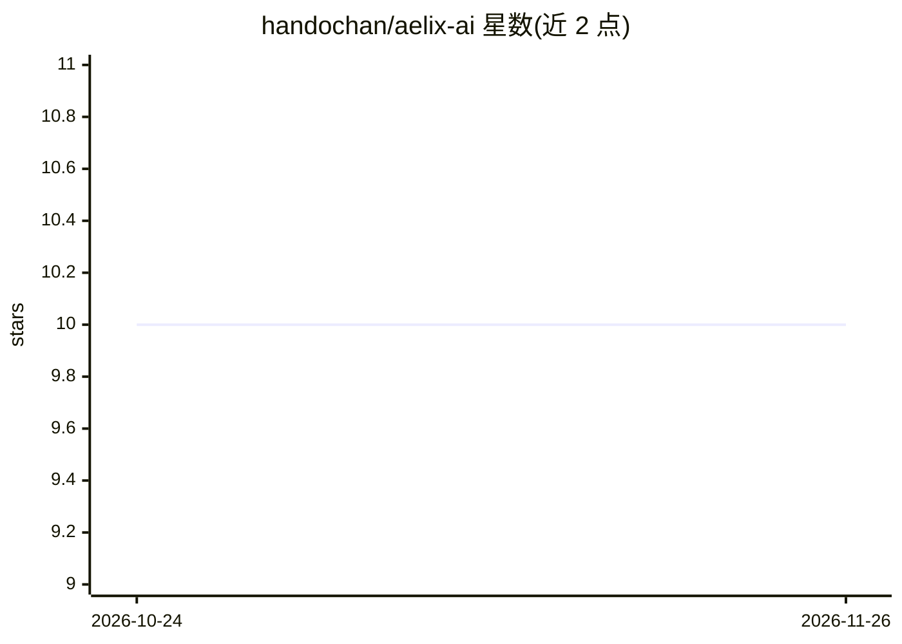

# handochan/aelix-ai

⭐ 10 · Python · Apache-2.0 · 推送 2026-11-25 · [GitHub](https://github.com/handochan/aelix-ai) · [官网](https://handochan.github.io/aelix-ai/) · 个人维护 · 中文 README

**自托管、可审计的纯 Python agent 运行时与扩展平台**

纯 Python 编写的 agent 运行时与扩展平台，当前以终端编码 agent 形态交付。扩展就是一个 Python 函数，ExtensionAPI 可注册工具、斜杠命令、provider、渲染器与主题，且支持热重载；agent 可自写工具并通过 /reload 热加载。支持 Anthropic、OpenAI、OpenRouter、Gemini/Vertex、Cloudflare、GitHub Copilot 六种按线路协议手写的适配器，按协议路由而非按厂商。无遥测，--offline 可关闭自身出站请求；提供 TUI、headless --print、JSON 与 RPC 模式，可嵌入 notebook、CI 与 Airflow 任务。Windows 支持标注为实验性。

## 筛选速览

| 维度 | 判定 | 备注 |
|---|---|---|
| AI 角色 | `ai-ecosystem` | LLM/agent 周边工具 |
| 许可风险 | `permissive` | Apache-2.0 |
| 部署形态 | `library` | 以包/库形式分发 |
| 模型依赖 | locked-api |  |
| 硬件要求 | — | 无带数字的原话,不猜 |
| 安装摩擦 | `low` | 无编译、无系统依赖或容器化 |
| 成熟度 | `idea` | |

## 能力要点

- 扩展即 Python 函数，支持工具/命令/provider 热重载
- 按线路协议手写六种 provider 适配器（anthropic-messages、openai-* 等）
- --offline 关闭全部自身出站请求，面向内网与客户现场部署
- headless --print / --mode json / --mode rpc 可嵌入流水线与 CI

## 适用场景

- 在自有网络边界内运行可审计的编码 agent
- 用 Python 函数扩展 agent 接入 DuckDB、内部 SDK 等数据栈
- 在 CI 或评测循环中以 JSON/RPC 模式嵌入 agent 调用
- 用已有的 Anthropic/OpenAI/Copilot 额度路由不同模型

## 场景标签

`编码 Agent` · 领域:编码与开发

## 证据(README 行号)

> L20: An agent runtime and extension platform in pure Python. It ships today as a terminal coding
> L144:  out-of-process bridge. The same `ExtensionAPI` registers tools, slash commands, providers,
> L181: Adapters are hand-written and keyed by **wire protocol**, not by vendor — no litellm, no

## 星数曲线

2026-10-24 10 → 2026-11-26 10（+0）

---
*卡片 v1 · prompt 1.4 · 生成 2026-11-19 · 置信度 mid · 依据 README sha `df06b84c8a90` · [字段定义](../../DATASET.md)*
