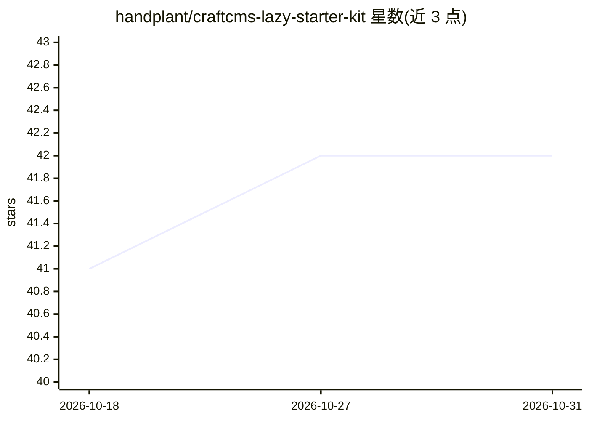

# handplant/craftcms-lazy-starter-kit

⭐ 42 · Twig · MIT · 推送 2026-09-18 · [GitHub](https://github.com/handplant/craftcms-lazy-starter-kit) · [官网](https://craft-kit.dev) · 个人维护

**Craft CMS 5 起步套件：面向机构的超媒体优先建站基线**

面向代理商、自由职业者与开发者的 Craft CMS 5 起步套件：以条目/字段/关系结构为核心，用 Craft 与 Twig 做服务端渲染，Datastar 通过 HTML 属性与 SSE 提供响应式交互，不要求 Vue/React 与客户端状态。技术栈含 Vite、Tailwind CSS v4、DDEV 本地环境。内置 Matrix/CKEditor 示例、SEO 配置（SEOMate）与 LLM Ready 插件——可输出 llms.txt 并在条目 URL 后加 .md 获取 Markdown 版本。附带演示数据库与示例内容（搜索、博客、地图等）。

## 筛选速览

| 维度 | 判定 | 备注 |
|---|---|---|
| AI 角色 | `ai-enhanced` | 去掉 AI 部分产品仍成立 |
| 许可风险 | `permissive` | MIT |
| 部署形态 | `None` |  |
| 模型依赖 | — | README 未给出锁定关系 |
| 硬件要求 | — | 无带数字的原话,不猜 |
| 安装摩擦 | `low` | 无编译、无系统依赖或容器化 |
| 成熟度 | — | 结构信号不足 |

## 能力要点

- 服务端渲染 + Datastar（SSE/HTML）超媒体优先架构
- LLM Ready 插件输出 llms.txt 与 .md 页面
- Vite + Tailwind CSS v4 + DDEV 本地开发环境
- 内置 Matrix、CKEditor、搜索、地图等真实示例

## 适用场景

- 以 Craft 条目模型为核心搭建服务端渲染网站
- 代理商快速起一个结构清晰的 Craft CMS 项目基线
- 让站点内容以 llms.txt / Markdown 形式供 LLM 读取

## 场景标签

 · 领域:Web 开发/CMS

## 证据(README 行号)

> L3: CraftCMS Lazy is a Craft CMS 5 starter kit for building fast, maintainable, server-rendered websites with Vite,
> L179: CraftCMS Lazy includes the LLM Ready Plugin. It can expose `llms.txt`

## 星数曲线

2026-10-18 41 → 2026-10-31 42（+1）

---
*卡片 v1 · prompt 1.4 · 生成 2026-10-25 · 置信度 high · 依据 README sha `6a5a19f37f1c` · [字段定义](../../DATASET.md)*
