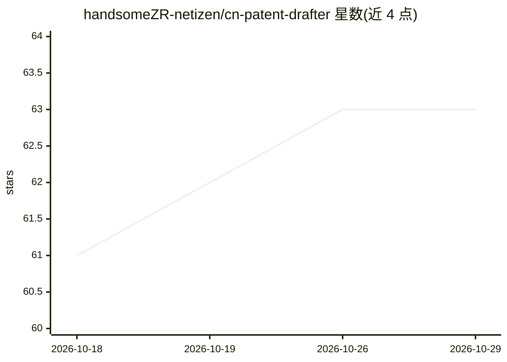

# handsomeZR-netizen/cn-patent-drafter

⭐ 63 · TeX · MIT · 推送 2026-05-06 · [GitHub](https://github.com/handsomeZR-netizen/cn-patent-drafter) · 个人维护 · 中文 README

**面向 Claude Code 的中国发明专利起草 Skill：按 CNIPA 规范出 PDF**

一个专为中国发明专利起草的 Claude Code Skill，将 CNIPA 2025-2026 申请文件规范、专利法第 25 条排除项、2024-12 AI 承诺指引等固化为一套结构化工作流：读合规清单、Grep 用户源码援引技术事实、套 LaTeX 占位模板、写前按 10 大类约 50 条 checklist 自检，再用 ctexart + xelatex 编译出五文档 PDF 交代理人转 XML。通过 git clone 安装到 .claude/skills/ 目录触发使用，已在 14 页真实样本上跑通端到端；不覆盖软著、实用新型/外观设计、其他司法辖区、OA 答辩与 XML 转换。

## 筛选速览

| 维度 | 判定 | 备注 |
|---|---|---|
| AI 角色 | `ai-native` | 本体是模型或模型工具 |
| 许可风险 | `permissive` | MIT |
| 部署形态 | `None` |  |
| 模型依赖 | locked-api |  |
| 硬件要求 | — | 无带数字的原话,不猜 |
| 安装摩擦 | `low` | 无编译、无系统依赖或容器化 |
| 成熟度 | — | 结构信号不足 |

## 能力要点

- CNIPA 2026 五文档规范 + 段号 [0001] 连续约定固化为工作流
- 10 大类约 50 条写前自检清单（含第 25 条排除项与 AI 承诺指引）
- ctexart + xelatex 工具链编译出 14 页可交付代理人的 PDF 样本
- 4 套 __PLACEHOLDER__ 占位骨架 + 从源码 Grep 援引技术细节

## 适用场景

- 从零起草符合 CNIPA 规范的发明专利五文档
- 对已有专利草稿做合规体检并列出问题项
- 增删改权利要求并避免循环引用、保持段号连续

## 场景标签

`AI 写作` · 领域:内容生成

## 证据(README 行号)

> L15: `cn-patent-drafter` 是一个**专为中国发明专利写的 Claude Code Skill**——不是 wrapper、不是抽奖式 Prompt 模板、不是搬运 USPTO 工作流。
> L17: 它把 CNIPA 2025-2026 现行的申请文件规范、专利法第 25 条排除项、2024-12 AI 承诺新规、说明书段号约定、权利要求引用约束……全部固化为一套 **「读清单 → 援引代码事实 → 套模板 → 写前自检 → 
> L65: - 从零起草一份完整 CN 发明专利申请文件（请求书 + 摘要 + 权利要求书 + 说明书 + 附图）

## 星数曲线

2026-10-18 61 → 2026-10-29 63（+2）

---
*卡片 v1 · prompt 1.4 · 生成 2026-10-24 · 置信度 high · 依据 README sha `739c94045e64` · [字段定义](../../DATASET.md)*
