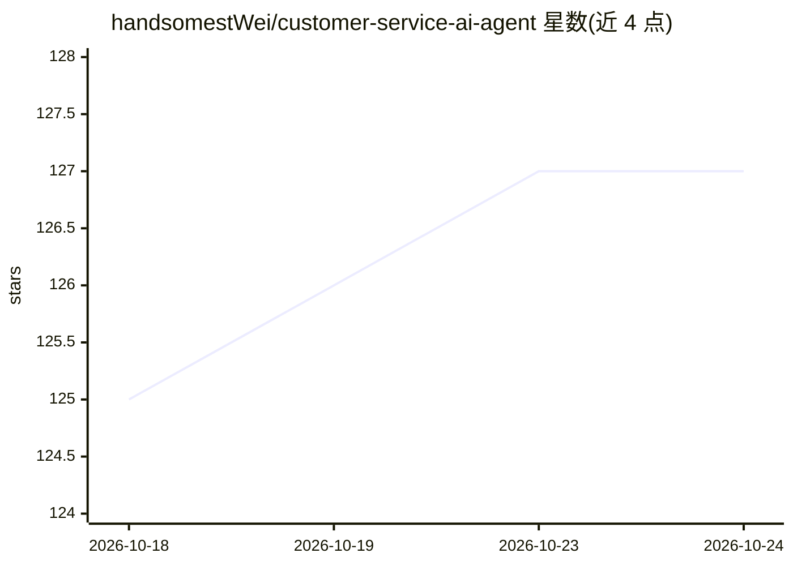

# handsomestWei/customer-service-ai-agent

⭐ 127 · Python · Apache-2.0 · 推送 2026-05-26 · [GitHub](https://github.com/handsomestWei/customer-service-ai-agent) · 个人维护 · 中文 README

**基于 LangGraph 的多智能体客服系统：多业务专家路由应答**

以 LangGraph 编排、Flask 提供 Web 前台的多智能体客服系统：客户查询经会话管理、查询分类后路由到产品咨询、技术支持、账单、投诉处理、综合客服等专家智能体，结合历史对话与 LangChain 记忆组件生成多轮连贯回答。工作流定义在 langgraph.json 配置文件中，支持条件路由，新智能体通过继承 BaseAgent 扩展。LLM 默认使用硅基流动 API（OpenAI 兼容接口），可通过环境变量切换服务商；提供 Studio UI、Web 服务与直接 API 三种运行方式。面向需要搭建客服系统的开发者。

## 筛选速览

| 维度 | 判定 | 备注 |
|---|---|---|
| AI 角色 | `ai-native` | 本体是模型或模型工具 |
| 许可风险 | `permissive` | Apache-2.0 |
| 部署形态 | `desktop` | 安装包/桌面程序 |
| 模型依赖 | — | README 未给出锁定关系 |
| 硬件要求 | — | 无带数字的原话,不猜 |
| 安装摩擦 | `low` | 无编译、无系统依赖或容器化 |
| 成熟度 | — | 结构信号不足 |

## 能力要点

- 查询分类后路由到产品/技术/账单/投诉等专家智能体
- 工作流由 langgraph.json 配置驱动，支持条件路由
- 多会话并发管理与 LangChain 长期记忆组件集成
- LLM 使用 OpenAI 兼容接口，默认硅基流动，可切换服务商

## 适用场景

- 搭建覆盖咨询、技术支持、账单、投诉的客服系统
- 学习 LangGraph 多智能体路由与工作流配置方法
- 按模块化方式扩展自有业务智能体和工具函数

## 场景标签

`多智能体` `聊天机器人` · 领域:Agent 开发

## 证据(README 行号)

> L13: 这是一个基于LangGraph构建的多智能体客服系统，支持产品咨询、技术支持、账单处理、投诉处理等多种业务场景。系统采用模块化设计，每个智能体独立运行，通过配置文件定义工作流程。
> L48: - **产品专家**: 产品信息咨询和推荐
> L111: 4. **智能体路由**: 根据查询类型路由到相应的专业智能体

## 星数曲线

2026-10-18 125 → 2026-10-24 127（+2）

---
*卡片 v1 · prompt 1.4 · 生成 2026-10-23 · 置信度 high · 依据 README sha `74af86362e81` · [字段定义](../../DATASET.md)*
