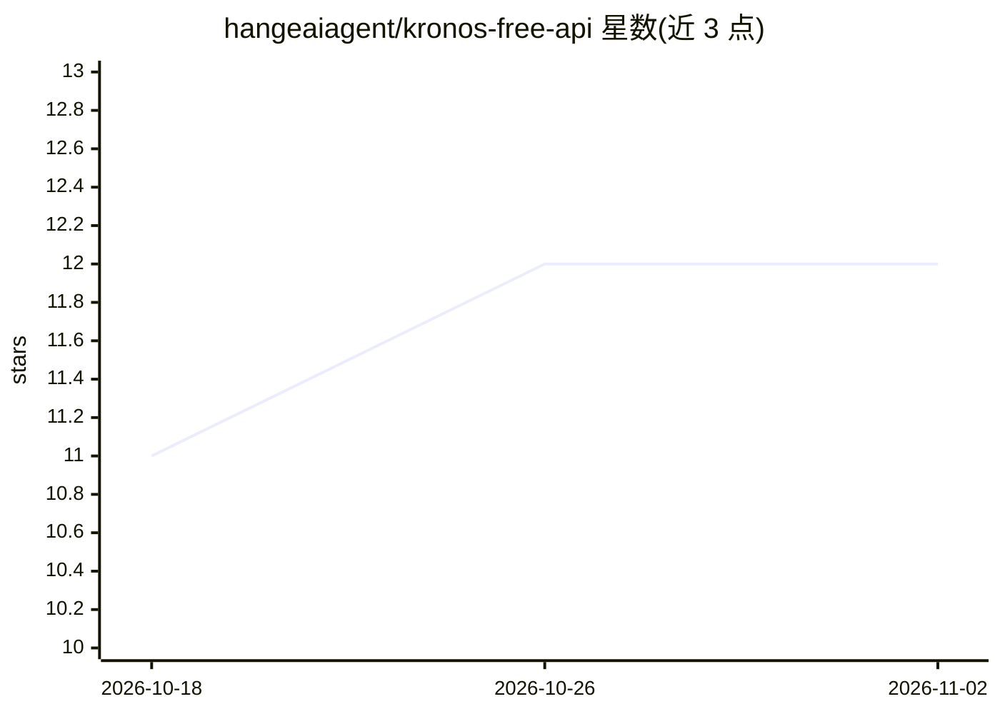

# hangeaiagent/kronos-free-api

⭐ 12 · 推送 2026-10-07 · [GitHub](https://github.com/hangeaiagent/kronos-free-api) · [官网](https://www.agentpit.io/finance-models) · 组织维护 · 中文 README

**面向量化开发者的免费金融AI API：K线预测+实时搜索**

AgentPit 运营的云端金融 AI API 服务，提供三个接口：Google 实时搜索（AI 生成摘要）、基于清华开源 Kronos 模型叠加 8 因子（主力净流入、均线、MACD、RSI、PE 等）的 K线预测（输出调整后 K线序列与五级评级），以及纯 Kronos 基础模型的原始 OHLCV 预测。用户注册账号申请 API Key 后通过 HTTP 调用，支持账号级自定义因子权重。仓库本身不包含可运行源码，本产品为在线服务，MIT 指仓库文档协议。

## 筛选速览

| 维度 | 判定 | 备注 |
|---|---|---|
| AI 角色 | `ai-native` | 本体是模型或模型工具 |
| 许可风险 | `permissive` | — |
| 部署形态 | `None` |  |
| 模型依赖 | — | README 未给出锁定关系 |
| 硬件要求 | — | 无带数字的原话,不猜 |
| 安装摩擦 | `low` | 无编译、无系统依赖或容器化 |
| 成熟度 | — | 结构信号不足 |

## 能力要点

- Kronos + 8 因子加权的 K线预测 API（1~30 日，五级评级）
- 纯 Kronos 基础模型接口输出原始 OHLCV 预测序列
- Google 实时搜索 API 附 AI 生成摘要
- 账号级自定义因子权重并在响应中回显实际权重

## 适用场景

- 量化策略中程序化获取 K线预测与多因子贡献明细
- 研报、新闻等金融资讯的实时搜索与摘要
- 学术场景下获取 Kronos 原始模型输出做因子融合或对比研究

## 场景标签

`金融量化` · 领域:学习与行业

## 证据(README 行号)

> L9: > 为量化开发者和金融研究者提供免费、开放的金融AI API接口
> L20: |📈 **基于清华Kronos开源大模型+公司信息数据调整：K线预测API**|清华大学开源金融模型Kronos **Pro 多因子模型**预测未来N日K线 + 评级|量化策略辅助、趋势研判、因子分析|
> L62: curl -X POST https://api.agentpit.io/v1/open-api/kpred \

## 星数曲线

2026-10-18 11 → 2026-11-02 12（+1）

---
*卡片 v1 · prompt 1.4 · 生成 2026-11-01 · 置信度 high · 依据 README sha `5a149e91dfeb` · [字段定义](../../DATASET.md)*
