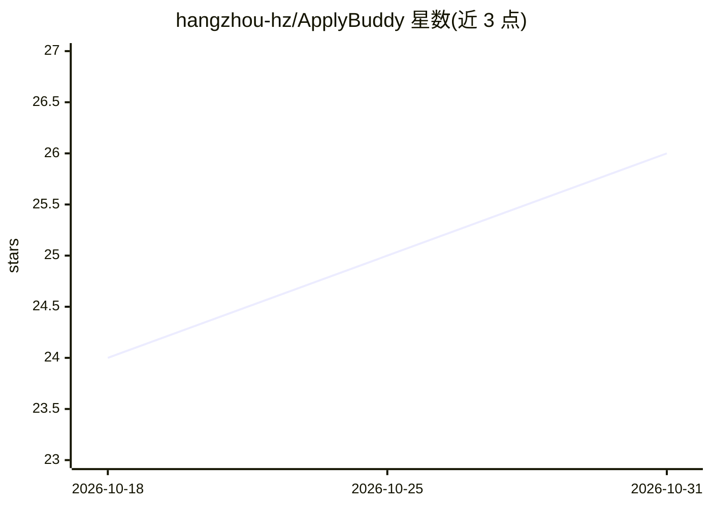

# hangzhou-hz/ApplyBuddy

⭐ 26 · MIT · 推送 2026-08-16 · [GitHub](https://github.com/hangzhou-hz/ApplyBuddy) · 个人维护 · 中文 README

**给求职者：在 Codex 中按规则执行找岗、筛选与投递的工作区**

面向求职者的规则驱动 AI 工作区，以完整仓库形式在 Codex 中打开使用。工作流覆盖职位发现、岗位有效性验证、硬性规则资格筛查、偏好排序、简历路由、复用已批准答案、去重与状态跟踪；关键机制是先评估再投递，且对无法由已批准事实支持的重要信息（工签、薪资、学历等）选择询问用户而非编造。用户主要只需编辑 config/ 与 resumes/ 两个文件夹。限制：真实 ATS 与浏览器行为未在所有平台充分测试，不保证投递成功，不绕过验证码或人工校验。

## 筛选速览

| 维度 | 判定 | 备注 |
|---|---|---|
| AI 角色 | `ai-native` | 本体是模型或模型工具 |
| 许可风险 | `permissive` | MIT |
| 部署形态 | `None` |  |
| 模型依赖 | — | README 未给出锁定关系 |
| 硬件要求 | — | 无带数字的原话,不猜 |
| 安装摩擦 | `low` | 无编译、无系统依赖或容器化 |
| 成熟度 | `idea` | |

## 能力要点

- 八阶段流程：发现→验证→资格筛查→匹配评估→选简历→投递→核验→跟踪
- 对无法支持的重要信息询问用户而非猜测
- 同一配置可切换 applybuddy 与 applybuddy-simplify 两种工作流
- 自动维护职位、投递尝试、阻碍项与跟进的跟踪文件

## 适用场景

- 按自己设定的硬性规则自动筛选并投递符合条件的职位
- 集中管理简历、偏好和已批准的申请答案，避免重复投递
- 跟踪每次申请的状态、阻碍项和后续跟进

## 场景标签

`工作流自动化` · 领域:效率与自动化

## 证据(README 行号)

> L7: ApplyBuddy is a rule-driven AI job application workspace for Codex. It helps you discover jobs, screen eligibility, 
> L83: 1. **Download ApplyBuddy** — download or clone the complete repository.

## 星数曲线

2026-10-18 24 → 2026-10-31 26（+2）

---
*卡片 v1 · prompt 1.4 · 生成 2026-10-27 · 置信度 mid · 依据 README sha `e7145674bb16` · [字段定义](../../DATASET.md)*
