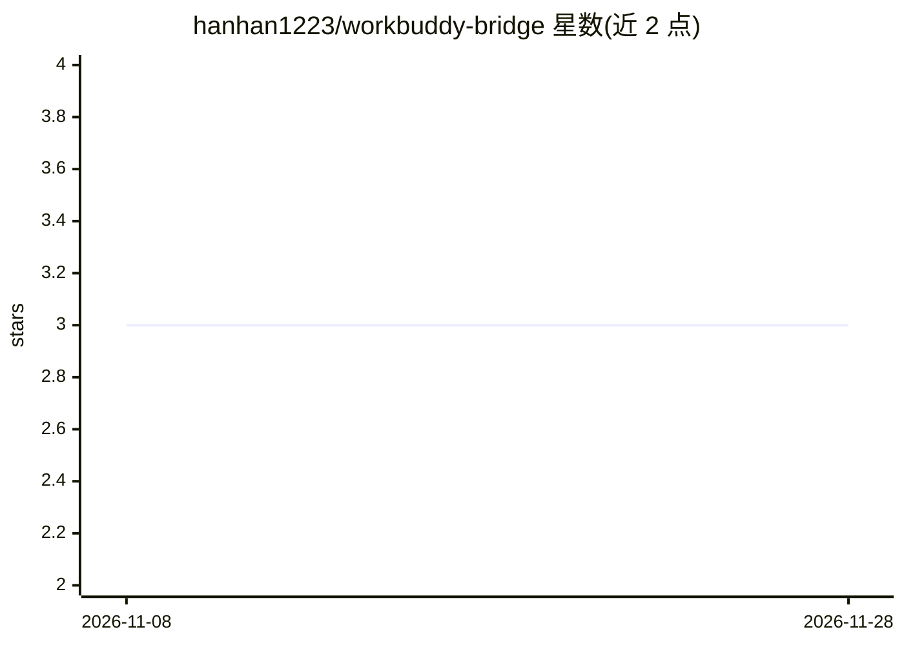

# hanhan1223/workbuddy-bridge

⭐ 3 · JavaScript · MIT · 推送 2026-10-14 · [GitHub](https://github.com/hanhan1223/workbuddy-bridge) · [官网](https://www.npmjs.com/package/workbuddy-bridge) · 个人维护 · 中文 README

**把 WorkBuddy 桌面账号变成 OpenAI/Anthropic 兼容 API 供编码 Agent 使用**

一个 Node.js 本地桥接服务：读取本机 WorkBuddy 桌面应用（国际版 ai / 中国版 cn）的登录凭据，将其模型以本地 HTTP API 形式暴露，支持 Anthropic Messages、OpenAI Chat Completions、OpenAI Responses 三种协议，供 Claude Code、Codex、CC Switch 等编码 Agent 作为模型提供方接入。含环境自检工具 workbuddy-doctor、模型目录探测（probe）、token 自动刷新与手动刷新。限制：仅支持 Windows、需 Node.js 20.3+、需已登录的 WorkBuddy 桌面应用，请求消耗用户自身账号配额。

## 筛选速览

| 维度 | 判定 | 备注 |
|---|---|---|
| AI 角色 | `ai-ecosystem` | LLM/agent 周边工具 |
| 许可风险 | `permissive` | MIT |
| 部署形态 | `desktop` | 安装包/桌面程序 |
| 模型依赖 | — | README 未给出锁定关系 |
| 硬件要求 | — | 无带数字的原话,不猜 |
| 安装摩擦 | `low` | 无编译、无系统依赖或容器化 |
| 成熟度 | — | 结构信号不足 |

## 能力要点

- 提供 Anthropic Messages / OpenAI Chat Completions / OpenAI Responses 三种兼容端点
- 自动探测国际版与中国版 WorkBuddy 应用，凭据解密验证后才能成为可用 provider
- workbuddy-doctor 环境自检与 --probe-models 模型可用性实测（结果缓存 30 分钟）
- token 到期前 5 分钟自动刷新、401 重试与 POST /refresh 手动刷新

## 适用场景

- 在 Claude Code / Codex 中把已订阅的 WorkBuddy 桌面账号用作模型后端
- 同一台机器上管理国际版与中国版两个账号的配额选择
- 通过 MCP 让 Agent 在选模型前先探测哪些模型真正可用

## 场景标签

`模型网关` · 领域:Agent 开发

## 证据(README 行号)

> L16: The models included with the WorkBuddy desktop app are normally usable only inside
> L19: protocols** can use it directly as a model provider.

## 星数曲线

2026-11-08 3 → 2026-11-28 3（+0）

---
*卡片 v1 · prompt 1.4 · 生成 2026-11-21 · 置信度 high · 依据 README sha `6ba4aca3d6de` · [字段定义](../../DATASET.md)*
